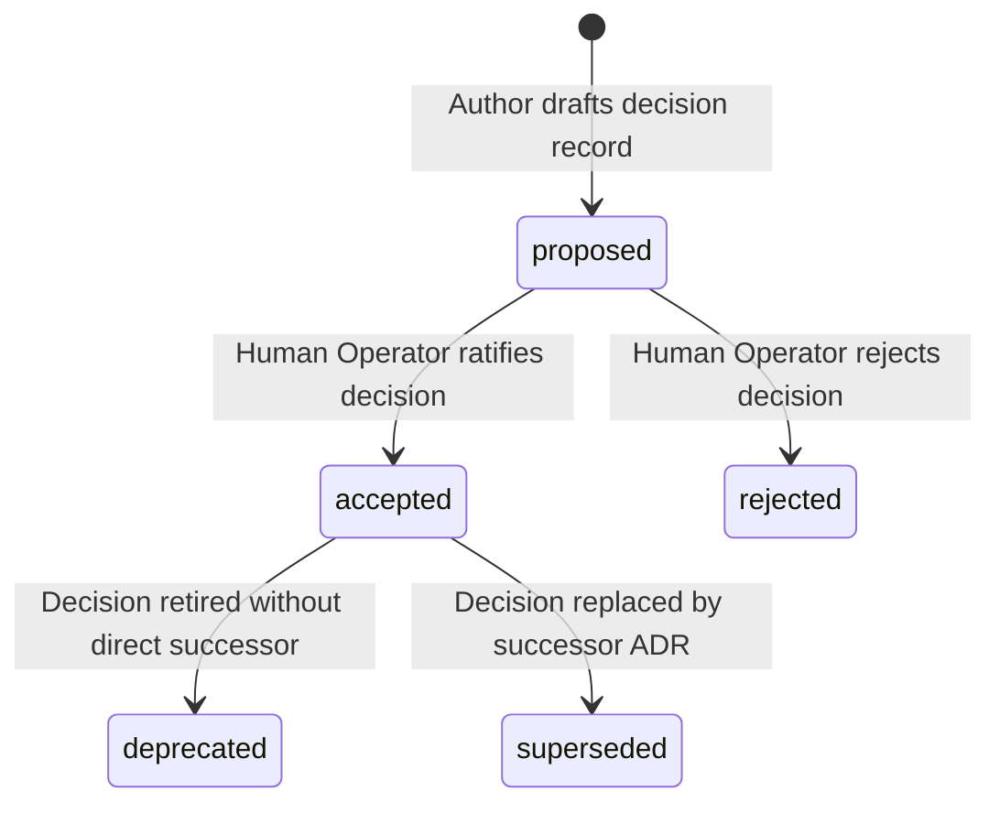
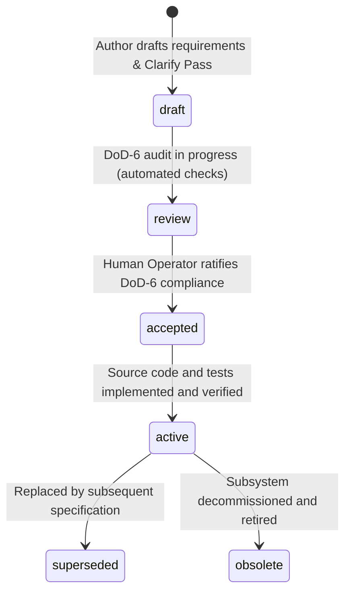
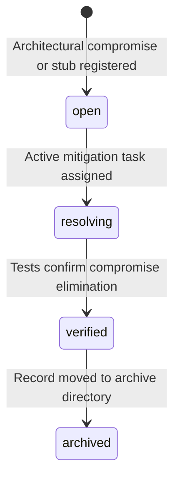

<!-- SPDX-FileCopyrightText: 2026 InsiderCrush -->
<!-- SPDX-License-Identifier: CC-BY-NC-4.0 -->

# ADR-L0-000001. Specifications Lifecycle, Bootstrap, and Bundle Architecture

## Status
Accepted

## Context
In software engineering environments where human engineers collaborate with Large Language Models (LLMs), engineering processes face three structural failure modes:
1. **Vibe-Coding:** Writing source code intuitively without prior architectural alignment, specification verification, or boundary constraints.
2. **Document-to-Code Drift:** Progressive divergence between written specifications, runtime implementations, and verification suites, rendering architectural documentation inaccurate.
3. **Document-to-Document Drift:** Internal contradictions, broken reference graphs, duplicated requirements, and orphaned documents within the specification corpus itself.

To eliminate these failure modes without introducing bureaucratic overhead, the system requires a deterministic, machine-verifiable meta-standard governing:
- The dichotomy between immutable architectural decisions and living system specifications.
- Formal Finite State Machine (FSM) models governing document transitions.
- A deterministic Spec-to-Code Gate (6-point Definition of Done) that prohibits source code generation until requirements are certified.
- Self-contained specification bundles (`{spec.md, plan.md, tasks.md}`) and entry point context budgets (`AGENTS.md`, `README.md`).
- An environment-agnostic hermetic portability invariant enforcing bundle-relative references (anchors resolve from the `governance/` bundle root).
- A mandatory bootstrap protocol (Bootstrap Mandate) requiring each downstream project to initialize its local living documentation engine and governance linters upon inception.

## Decision

### R1. Document Classification and Mutability Dichotomy
The repository documentation corpus shall strictly maintain two classes of records:
1. **Immutable Records (Architecture Decision Records - ADR):** Architectural decisions, invariants, and structural trade-offs. Once accepted, an ADR shall never be modified in-place. Evolution occurs exclusively via new records linked through `supersedes` and `superseded-by` relationship pointers.
2. **Living Records (Software Design Documents - SDD, Manifests, and Runbooks):** Specifications, implementation plans, checklists, glossaries, and entry points. Living records shall be updated synchronously with code within the same transaction, pull request, or commit cycle.

**Human Authority Invariant:** Autonomous AI agents are authorized to draft proposed architectural records, but only a human operator holds valid authority to transition an ADR to `accepted`.

### R2. Document Lifecycle Finite State Machines (FSM)

#### 1. Architecture Decision Record (ADR) FSM

- `proposed`: Initial state under active evaluation. Non-binding on implementation.
- `accepted`: Formally approved by human operator. Binding on all downstream artifacts.
- `rejected`: Evaluated and declined. Retained permanently for historical rationale.
- `deprecated`: Formerly binding decision declared obsolete without replacement.
- `superseded`: Superseded by a newer ratified ADR referenced in `superseded-by`.

#### 2. Software Design Document (SDD) FSM

- `draft`: Requirement formulation and clarification. Code generation strictly prohibited.
- `review`: Verification against the 6-point Definition of Done.
- `accepted`: Certified for implementation. Code synthesis authorized.
- `active`: Fully implemented with verified test coverage.
- `superseded`: Obsoleted by a successor specification.
- `obsolete`: Retired from active execution.

#### 3. Architectural Debt Record (DEBT) FSM

- Any intentional temporary compromise, stub, or performance shortcut shall instantly produce an architectural debt record in `./specs/debt/DEBT-[LAYER]-NNNNNN.md`.
- No specification bundle shall transition to final certified release while blocking debt records remain in `open` or `resolving` states.

### R3. Spec-to-Code Gate (6-Point Definition of Done)
An SDD shall transition from `review` to `accepted` and authorize source code generation if and only if all six conditions are satisfied:
1. **EARS Conformance (DoD-1):** 100% of functional requirements strictly follow the six canonical Easy Approach to Requirements Syntax (EARS) patterns with unique `REQ-L<Layer>-<DocIndex>-<ItemIndex>` identifiers.
2. **Quantitative Thresholds (DoD-2):** Every non-functional attribute contains explicit, numerically measurable thresholds (latency SLAs in milliseconds, memory buffers in bytes, retry counts).
3. **State Transition Visualizations (DoD-3):** All dynamic lifecycle behaviors, state machines, and execution phases contain valid text-based Mermaid state diagrams.
4. **Contract Schemas (DoD-4):** All architectural interfaces, inputs, outputs, and storage entities define explicit typed data schemas.
5. **Clarify Pass Closure (DoD-5):** The "Questions (Clarify Pass)" section is completely empty, certifying zero unresolved functional ambiguities.
6. **Closed-Vocabulary Membership (DoD-6):** Every identifier, status token, state name, path, and entity name is registered in the project glossary Dual-Key Matrix or governed by a ratified ADR.

### R4. Specification Bundle Architecture
Subsystems, features, or architectural modules requiring non-trivial implementation shall be formalized either as a standalone specification (`SDD-[LAYER]-NNNNNN-title.md`) or as a self-contained Specification Bundle inside a dedicated directory:
```
./specs/[subsystem]/
├── spec.md      # Requirements, functional goals, EARS contracts, and acceptance criteria
├── plan.md      # Technical architecture, C4 diagrams, FSM models, and data contracts
└── tasks.md     # Step-by-step implementation checklist and living documentation sync tasks
```
- **Budget Constraint:** The primary `spec.md` body shall not exceed 150 lines (or 1,500 tokens). Specifications exceeding this threshold shall be decomposed into modular sub-specifications.
- **Clarify Pass Section:** Every `spec.md` must incorporate a `## Questions (Clarify Pass)` section prior to implementation authorization.

### R5. Entry Point Line Budgets and Portability Invariants
1. **AGENTS.md Budget:** The canonical entry point for automated agents (`./AGENTS.md`) shall strictly respect a context budget of <= 120 lines in active operational mode, and <= 15 lines in cold-boot mode. Detailed domain guidance must be delegated to modular specification files.
2. **README.md Budget:** The primary human entry point (`./README.md`) shall strictly respect a context budget of <= 100 lines, operating as an Operational Dispatch Router directing engineers to underlying standards.
3. **Hermetic Portability Invariant (Zero-Host-Assumption):**
   - Host-absolute paths (starting with `/` on POSIX or `[A-Z]:\` on Windows) are strictly prohibited across all documentation, manifests, configurations, and specifications.
   - All filesystem paths and cross-document hyperlinks shall resolve using bundle-relative anchors starting with `./`, where the bundle root is the `governance/` directory containing this corpus.

### R6. Graph Integrity and Structural Completeness
The documentation graph shall be continuously verified by static governance tooling:
1. **Broken References (`BROKEN-REF`):** Every cross-document hyperlink, anchor, or REQ pointer must resolve to an existing file and section.
2. **Duplicate Requirements (`DUP-REQ`):** Every requirement identifier must be globally unique across the repository.
3. **Orphaned Documents (`ORPHAN-DOC`):** Every specification document must be registered in the repository's Norm Applicability Manifest and linked to the interaction map.
4. **Structural Completeness (Fail-Closed):** Documents lacking mandatory structural sections corresponding to their lifecycle state shall fail governance validation.

### R7. Project Bootstrap Mandate
Every downstream repository initialized from this template shall execute an automated initialization check (`bootstrap-check`):
1. The project must generate its local living specifications (documentation engine and governance linter classes); concrete SDD indices are allocated downstream from the project-owned band (000101+) per the numbering rules of ADR-L0-000002. The template carries no concrete SDD indices.
2. The project must instantiate its local governance linter (`<governance_linter_executable>` or equivalent engine) driven by a declarative rule pack.
3. The pre-commit gate shall enforce that no domain implementation code is authored until the bootstrap check passes with zero errors.

### R8. Bundle Directory Skeleton
The `governance/` bundle shall be fully self-describing and maintain exactly one normative directory skeleton:
```text
./AGENTS.md            # Agent entry point (line budget per R5)
./README.md            # Human and LLM entry point (line budget per R5)
./specs/               # Immutable ADR corpus (linter zone, non-recursive)
./specs/standards/     # Living-record zone for project-allocated SDDs
./instruments/         # Governance executables (read-only per DEBT A4)
./tests/               # Test universe: own laws, own ADRs, own specs; outside the corpus; never scanned by the main linter
./new-adr/             # Method workspace; intake and staging zones
./new-code/            # Method workspace for code fabrication
./norm-manifest.yaml   # File-to-norm registration gate
./interaction_map.yaml # Module-to-spec ownership map
./specs/glossary.md    # Closed vocabulary
```
- All internal references resolve bundle-relative from this root (see R5).
- Directionality: `./specs/` shall never reference `./tests/`; the test universe reads `./specs/` as its oracle.
- The ADR compiler verifies this skeleton at startup (ERR-COMPILER-11 LAYOUT-STAMP-MISMATCH); the skeleton is normative for every downstream instantiation of this template.
- An entry absent from a concrete instantiation constitutes a registered instantiation gap (DEBT A19), not a skeleton violation.

### R8.1. Instrument Instantiation Contract (normative)
1. Instrument classes are normative; deployment paths are not. The ratified class names are linter.py (governance linter) and compiler.py (ADR compiler); linter_v2.py and adr_compiler.py are interim instances of these classes.
2. Instrument instances reside in `./instruments/` and are read-only per DEBT A4; the internal layout of `./instruments/` is interim pending class rebirth.
3. Relocation or renaming of an instrument instance is permitted exclusively at class rebirth (DEBT A16); interim instances shall not be moved or renamed.
4. The corpus zone of the governance linter class is `./specs/`, non-recursive; every other R8 zone is outside the linter scope.

## Requirements (EARS)

- **REQ-L0-000001-001 (Ubiquitous):**
  The documentation system shall classify every repository document into strictly one of two mutability classes: Immutable Records (ADRs) or Living Records (SDDs, manifests, runbooks, and glossary) under error `ERR-L0-000001-11`.
  | Verification: test_document_classification_immutability()

- **REQ-L0-000001-002 (Unwanted behaviour):**
  If an accepted ADR is modified in-place without generating a distinct superseding ADR, then the governance gatekeeper shall reject the modification with exit code 1 under error `ERR-L0-000001-1`.
  | Verification: test_adr_in_place_mutation_rejection()

- **REQ-L0-000001-003 (State-driven):**
  While an SDD is in `draft` or `review` status, the system shall prohibit source code synthesis and reject implementation commits under error `ERR-L0-000001-2`.
  | Verification: test_spec_to_code_gate_enforcement()

- **REQ-L0-000001-004 (Complex):**
  While an SDD is in `review` status, When evaluation against the 6-point Definition of Done occurs, If any of the six DoD criteria is unmet, then the governance linter shall block transition to `accepted` under error `ERR-L0-000001-3`.
  | Verification: test_dod6_criteria_verification()

- **REQ-L0-000001-005 (Event-driven):**
  When a feature or subsystem requires multi-step implementation, the author shall structure the specification as a self-contained bundle containing `spec.md`, `plan.md`, and `tasks.md`, maintaining `spec.md` within a limit of <= 150 lines under error `ERR-L0-000001-4`.
  | Verification: test_sdd_bundle_structure_and_budget()

- **REQ-L0-000001-006 (State-driven):**
  While resident in the workspace root, the entry point file `AGENTS.md` shall maintain a total line count of not more than 120 lines in active operational mode and not more than 15 lines in cold-boot mode under error `ERR-L0-000001-4`.
  | Verification: test_agents_md_line_budget()

- **REQ-L0-000001-007 (State-driven):**
  While resident in the workspace root, the entry point file `README.md` shall maintain a total line count of not more than 100 lines under error `ERR-L0-000001-4`.
  | Verification: test_readme_md_line_budget()

- **REQ-L0-000001-008 (Unwanted behaviour):**
  If any specification, manifest, configuration, or documentation file embeds a host-absolute filesystem path starting with `/` or `[A-Z]:\`, then the governance linter shall reject the file under error `ERR-L0-000001-5`.
  | Verification: test_hermetic_portability_relative_paths()

- **REQ-L0-000001-009 (Ubiquitous):**
  The documentation validator shall verify the directional reference graph across all specification artifacts, failing validation upon detecting broken references, duplicate requirements, or unreferenced specifications under error (ERR-L0-000001-6, ERR-L0-000001-7, ERR-L0-000001-8).
  | Verification: test_reference_graph_integrity()

- **REQ-L0-000001-010 (Event-driven):**
  When an architectural compromise or temporary implementation shortcut is introduced, the author shall register a corresponding debt record in `./specs/debt/DEBT-[LAYER]-NNNNNN.md` with initial state `open` under error `ERR-L0-000001-12`.
  | Verification: test_debt_record_registration()

- **REQ-L0-000001-011 (Complex):**
  While any associated architectural debt record remains in `open` or `resolving` status, When a specification attempts final release certification, then the gatekeeper shall reject certification under error `ERR-L0-000001-9`.
  | Verification: test_debt_blocking_release()

- **REQ-L0-000001-012 (Event-driven):**
  When a new repository is initialized from this template, the bootstrap verification routine shall assert the existence and structural completeness of the project's living specifications under error `ERR-L0-000001-10`.
  | Verification: test_bootstrap_mandate_initialization()

- **REQ-L0-000001-013 (State-driven):**
  While verifying a governance bundle, the ADR compiler shall reject any deviation from the R8 directory skeleton that is not registered as an instantiation gap under error `ERR-L0-000001-13`.
  | Verification: test_skeleton_completeness_assertion()

- **REQ-L0-000001-014 (Ubiquitous):**
  Every document in the `./specs/` corpus shall carry the copyright and license notices as markdown meta-comments immediately after the frontmatter under error `ERR-L0-000001-14`.
  | Verification: test_license_notice_meta_comment()

## Checks & Verification Matrix

| Check Name | Target Artifact | Verification Gate | Error Code | Failure Condition |
| :--- | :--- | :--- | :--- | :--- |
| ADR Immutability Guard | `./specs/*.md` | pre-commit / CI | `ERR-L0-000001-1` | In-place modification of an `accepted` ADR. |
| Spec-to-Code Gate | `./specs/**/*.md`, `./src/**` | pre-commit / CI | `ERR-L0-000001-2` | Code committed against `draft` or `review` specification. |
| DoD-6 Completeness Check | `./specs/**/*.md` | pre-commit / CI | `ERR-L0-000001-3` | Transition to `accepted` with missing EARS, SLAs, schemas, or non-empty Clarify Pass. |
| Context Budget Guard | `./AGENTS.md`, `./README.md`, `spec.md` | pre-commit / CI | `ERR-L0-000001-4` | Line count exceeds 120 (AGENTS), 100 (README), or 150 (spec.md). |
| Hermetic Portability Guard | All repository markdown/config | pre-commit / CI | `ERR-L0-000001-5` | Presence of host-absolute paths (`/` or `[A-Z]:\`). |
| Reference Graph Checker | All repository markdown files | pre-commit / CI | `ERR-L0-000001-6` | Unresolved target URI, anchor, or cross-reference (`BROKEN-REF`). |
| Requirement Uniqueness Check | All specification files | pre-commit / CI | `ERR-L0-000001-7` | Identical `REQ-L<Layer>-<DocIndex>-<ItemIndex>` declared in multiple locations (`DUP-REQ`). |
| Orphan Document Guard | `./specs/**/*.md` | pre-commit / CI | `ERR-L0-000001-8` | Specification unlinked in manifest or interaction map (`ORPHAN-DOC`). |
| Blocking Debt Guard | `./specs/debt/*.md` | CI (Release) | `ERR-L0-000001-9` | Release tagged while debt record remains `open` or `resolving`. |
| Bootstrap Mandate Check | `./specs/standards/` | pre-commit / CI | `ERR-L0-000001-10` | Downstream repository missing its locally allocated living specifications. |
| Document Mutability Classification | `./specs/**/*.md` | pre-commit / CI | `ERR-L0-000001-11` | Document class undefined or violates immutability rules. |
| Debt Record Registration Gate | `./specs/debt/*.md` | pre-commit / CI | `ERR-L0-000001-12` | Unregistered architectural debt or invalid initial debt state. |
| Skeleton Completeness Check | `./governance/` bundle | pre-commit / CI | `ERR-L0-000001-13` | R8 skeleton entry missing without a registered instantiation gap. |
| License Notice Guard | `./specs/*.md` | pre-commit / CI | `ERR-L0-000001-14` | Copyright or license notice missing, misplaced, or emitted as visible text. |

## Error Catalog & Machine Remediation

- **`ERR-L0-000001-1` (IMMUTABLE-RECORD-MUTATED):**
  - *Trigger:* Attempted modification of an ADR in `accepted` state.
  - *Action:* Revert local edits to the accepted ADR. Create a new ADR with status `proposed` and link it via `supersedes`.
- **`ERR-L0-000001-2` (PREMATURE-CODE-FABRICATION):**
  - *Trigger:* Implementation code detected while parent specification is in `draft` or `review`.
  - *Action:* Complete specification requirements, pass the DoD-6 gate, and secure human operator acceptance prior to code creation.
- **`ERR-L0-000001-3` (DOD6-CRITERIA-UNMET):**
  - *Trigger:* Specification attempted transition to `accepted` without meeting all six Definition of Done criteria.
  - *Action:* Resolve all items in `Questions (Clarify Pass)`, format all functional requirements in EARS, add quantitative SLAs, and verify glossary membership.
- **`ERR-L0-000001-4` (CONTEXT-BUDGET-EXCEEDED):**
  - *Trigger:* File line count exceeds maximum threshold (`AGENTS.md` > 120/15, `README.md` > 100, `spec.md` > 150).
  - *Action:* Trim redundant prose, remove conversational commentary, and modularize details into referenced sub-specifications.
- **`ERR-L0-000001-5` (HOST-ABSOLUTE-PATH-DETECTED):**
  - *Trigger:* Host-absolute filesystem path detected in documentation or specification.
  - *Action:* Replace absolute paths with workspace-relative `./` anchored paths.
- **`ERR-L0-000001-6` (BROKEN-REF):**
  - *Trigger:* Link resolves to a missing file, deleted header anchor, or non-existent requirement ID.
  - *Action:* Update target URI to a valid anchor or restore missing reference target.
- **`ERR-L0-000001-7` (DUP-REQ):**
  - *Trigger:* Requirement ID collision detected across the specification corpus.
  - *Action:* Re-allocate a unique requirement identifier from the document-scoped range defined in ADR-L0-000002.
- **`ERR-L0-000001-8` (ORPHAN-DOC):**
  - *Trigger:* Specification document not indexed in the Norm Applicability Manifest.
  - *Action:* Register the document path and applicable rules in `./norm-manifest.yaml`.
- **`ERR-L0-000001-9` (UNRESOLVED-DEBT-BLOCK):**
  - *Trigger:* Release gate triggered while associated architectural debt records remain unarchived.
  - *Action:* Execute remediation tasks, verify fixes via automated tests, and transition debt records to `archived`.
- **`ERR-L0-000001-10` (BOOTSTRAP-MANDATE-FAILED):**
  - *Trigger:* Downstream repository initialization attempted without creating required local living specifications.
  - *Action:* Initialize the locally allocated living specifications (documentation engine and governance linter classes) with mandatory structural sections.

- **`ERR-L0-000001-11` (INVALID-DOCUMENT-CLASSIFICATION):**
  - *Trigger:* Document created without valid classification as Immutable Record (ADR) or Living Record.
  - *Action:* Classify document under `./specs/` or appropriate living specification directory.

- **`ERR-L0-000001-12` (DEBT-RECORD-UNREGISTERED):**
  - *Trigger:* Architectural compromise introduced without registered `DEBT-*.md` in `./specs/debt/`.
  - *Action:* Create corresponding debt record in `./specs/debt/` with initial status `open`.

- **`ERR-L0-000001-13` (SKELETON-DEVIATION-UNREGISTERED):**
  - *Trigger:* An R8 skeleton entry is absent from a governance bundle without a corresponding registered instantiation gap.
  - *Action:* Restore the missing skeleton entry or register an instantiation gap record per DEBT A19.

- **`ERR-L0-000001-14` (LICENSE-NOTICE-INVALID):**
  - *Trigger:* A corpus document lacks the copyright and license notices, or the notices are not markdown meta-comments immediately after the frontmatter.
  - *Action:* Insert the SPDX copyright and license notices as markdown meta-comments immediately after the frontmatter closing fence.

## Consequences

### Positive
- Prevents unaligned vibe-coding by locking source code generation behind a verifiable 6-point gate.
- Eliminates documentation drift by enforcing synchronous updates for living records and immutable chains for architectural records.
- Preserves LLM context economy through strict line budgets on top-level entry points and specification bundles.
- Ensures environment portability across heterogeneous container runtimes and IDEs via `./` path anchoring.
- Establishes a predictable, fail-closed governance model with automated machine-readable error codes.

### Negative
- Requires developer and agent discipline to maintain living documentation in the same commit transaction as code changes.
- Requires initial project setup time to author local living specifications and configure the governance linter during repository bootstrapping.

## Alternatives Considered
- **Unstructured Single Documentation Folder:** Rejected. Conflating architectural decisions with living technical designs leads inevitably to documentation drift and stale guidance.
- **External Wiki / Issue-Tracker Governance:** Rejected. Removing specifications from the git repository prevents atomic, synchronous verification of code and documentation changes.
- **In-Place ADR Modification:** Rejected. Permitting retrospective editing of accepted decisions obscures historical context and breaks backward compatibility of architectural rationale.
