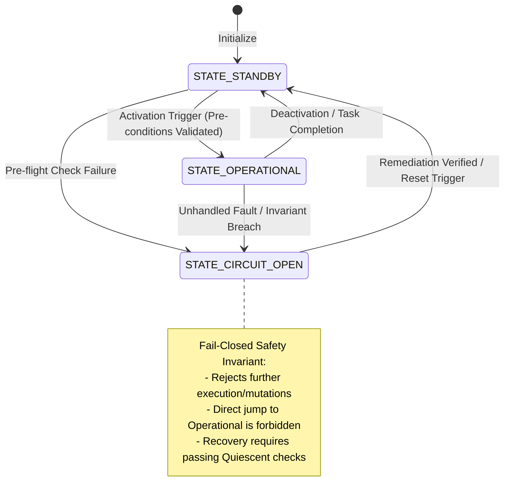

<!-- SPDX-FileCopyrightText: 2026 InsiderCrush -->
<!-- SPDX-License-Identifier: CC-BY-NC-4.0 -->

# ADR-L0-000005. FSM Grammar, Syntax, and System Registry

## Status
Accepted

## Context
Across software architectures, Finite State Machines (FSMs) model operational lifecycles, execution boundaries, error handling, and behavioral protocols. Without a standardized, machine-verifiable grammar and formal registry rules, systems suffer from common architectural failure modes:
1. **Syntactic and Token Inconsistency:** Free-form naming of states across code, schemas, and documentation (mixing camelCase, snake_case, arbitrary prefixes, or ad-hoc strings like `"active"`, `"working"`, `"error"`) causes static analysis failures, regex mismatches, and automated testing blind spots.
2. **Artificial Nested Subphases:** Overly rigid syntactic conventions that mandate a subphase for every state create artificial, non-functional states (e.g., `STATE_STANDBY_IDLE`, `STATE_OPERATIONAL_ACTIVE`), unnecessarily expanding the state space and complicating transition matrices.
3. **Unratified State Tokens:** Autonomous agents and developers frequently introduce ad-hoc state identifiers directly into code or database columns without registering them in the system schema, leading to silent state drift and unhandled edge cases.
4. **Undefined Transition and Fault Boundaries:** Missing formal transition matrices and absent fail-closed policies leave state machines vulnerable to undefined runtime states or silent hangs when unexpected exceptions occur.
5. **Legacy Prefix Coupling:** Coupling state enumerations to transient organizational, platform, or historical prefixes prevents specifications and state machines from remaining clean, reusable, and portable templates.

To establish a completely decoupled, clean, and reusable architectural template for all downstream systems, this standard defines:
- A canonical, machine-verifiable grammar for all FSM state tokens with optional subphases.
- Rules for declaring closed, domain-specific state registries in project specifications.
- Formal transition matrix invariants, including fail-closed isolation semantics.
- Static analysis and pre-commit verification gates that detect unratified tokens and malformed transitions.

## Decision

### R1. Canonical FSM Token Grammar
1. **Grammatical Pattern:** Every Finite State Machine state identifier across specifications, code, database schemas, and diagrams shall conform to the canonical template:
   ```
   STATE_<PHASE>[_<SUBPHASE>]
   ```
2. **Subphase Optionality:** The `<SUBPHASE>` token is strictly optional. When a state represents a discrete phase without behavioral subdivisions, only `<PHASE>` shall be used.
3. **Regular Expression Invariant:** All FSM state tokens shall match the strict regular expression:
   ```regex
   ^STATE_[A-Z0-9]+(_[A-Z0-9]+)?$
   ```
4. **Delimiters and Casing:**
   - Must begin with the prefix `STATE_`.
   - Contain strictly uppercase alphanumeric ASCII characters (`[A-Z0-9]`).
   - Words within a phase or subphase are not multi-delimited; single underscore (`_`) separates `STATE_`, `<PHASE>`, and `<SUBPHASE>`.
5. **Prohibition of Legacy and Transient Prefixes:**
   - Legacy prefixes (e.g., `CROSS_`, `TEMP_`, `CUSTOM_`) in state tokens are strictly prohibited.
6. **Prohibition of Redundant Subphases:**
   - Subphases that duplicate phase semantics without creating a distinct behavioral branch (e.g., `STATE_READY_READY`, `STATE_STANDBY_IDLE`, `STATE_ACTIVE_RUNNING`) are strictly prohibited.

### R2. State Registry Declaration Framework
1. **Closed Vocabulary Requirement:** Each subsystem implementing an FSM shall declare a closed enumeration of ratified state tokens in its respective Software Design Document (SDD) or schema specification.
2. **Standard Lifecycle Roles:** While specific business domain tokens vary per project, any core lifecycle FSM shall classify its states into standard roles:
   - **Quiescent / Initial:** Baseline state awaiting trigger or bootstrap.
   - **Operational / Active:** State executing primary domain tasks.
   - **Isolated / Fault:** Safe fallback state isolating failures and preventing unauthorized mutations.
3. **Ratification Gate:** Introducing, modifying, or removing a state token requires updating the ratified specification registry. Unregistered state tokens in code or migrations are rejected at build/lint time.

### R3. Deterministic State Transition Matrix and Fail-Closed Invariants
1. **Explicit Transition Graph:** Every FSM shall define an exhaustive directed transition matrix specifying valid `(source_state, trigger) -> target_state` mappings.
2. **Prohibition of Undefined Transitions:** Any trigger received in a state that does not have an explicit transition defined shall be handled as an illegal transition error rather than silently ignored.
3. **Fail-Closed Isolation Fallback:**
   - When an unhandled runtime exception or invariant breach occurs during execution in any operational state, the FSM supervisor shall transition to a defined safe/isolated state.
   - Direct recovery from an isolated/fault state to active operational execution without passing through verification/initialization checks is strictly prohibited.

### R4. Automated Static Analysis and CI Gates
1. **AST and Token Scanner:** Automated linters and pre-commit hooks shall scan specifications, source files, schemas, and diagrams to verify that:
   - All state tokens strictly adhere to `^STATE_[A-Z0-9]+(_[A-Z0-9]+)?$`.
   - All referenced state tokens exist in the ratified project state registry.
   - Legacy prefixes and redundant subphases are rejected.
2. **Transition Validation:** Unit tests shall verify the integrity of the transition matrix, confirming that all allowed paths are reachable and all invalid transitions are rejected.

## State Lifecycle Model (Reference Pattern)



## Requirements (EARS)

- **REQ-L0-000005-001 (Ubiquitous):**
  The system shall restrict all Finite State Machine (FSM) state identifiers across specifications, schemas, diagrams, and source code to the canonical grammar pattern `STATE_<PHASE>[_<SUBPHASE>]` under error `ERR-L0-000005-1`.
  | Verification: test_fsm_token_grammar_conformance()

- **REQ-L0-000005-002 (Ubiquitous):**
  The documentation and engineering system shall require every module implementing an FSM to define a closed registry of ratified state tokens in its design specification under error `ERR-L0-000005-4`.
  | Verification: test_fsm_module_registry_completeness()

- **REQ-L0-000005-003 (Unwanted behaviour):**
  If an FSM state token matches a legacy or deprecated prefix, then the governance linter shall reject the artifact with exit code 1 under error `ERR-L0-000005-2`.
  | Verification: test_legacy_prefix_rejection()

- **REQ-L0-000005-004 (Unwanted behaviour):**
  If an FSM state token contains a redundant or non-functional subphase, then the governance linter shall reject the artifact under error `ERR-L0-000005-3`.
  | Verification: test_redundant_subphase_rejection()

- **REQ-L0-000005-005 (Unwanted behaviour):**
  If an unratified or unregistered state token is detected in any codebase or specification artifact, then the static verification gate shall halt execution under error `ERR-L0-000005-4`.
  | Verification: test_unratified_state_token_rejection()

- **REQ-L0-000005-006 (State-driven):**
  While in a fault or isolated state (`STATE_CIRCUIT_OPEN`), the state supervisor shall reject direct transitions to active operational execution and permit transitions only to the quiescent initialization state (`STATE_STANDBY`) following remediation under error `ERR-L0-000005-5`.
  | Verification: test_isolation_recovery_boundary()

- **REQ-L0-000005-007 (Unwanted behaviour):**
  If an unhandled exception or runtime invariant breach occurs during execution in an operational state (`STATE_OPERATIONAL`), then the state supervisor shall execute a deterministic transition to the registered isolated state (`STATE_CIRCUIT_OPEN`) under error `ERR-L0-000005-6`.
  | Verification: test_fail_closed_emergency_transition()

- **REQ-L0-000005-008 (Event-driven):**
  When a state transition trigger is dispatched, the transition engine shall verify that the transition is explicitly permitted by the ratified transition matrix before mutating the state under error `ERR-L0-000005-5`.
  | Verification: test_transition_matrix_enforcement()

- **REQ-L0-000005-009 (Unwanted behaviour):**
  If a state token fails to match the regular expression `^STATE_[A-Z0-9]+(_[A-Z0-9]+)?$`, then the static analyzer shall abort verification under error `ERR-L0-000005-1`.
  | Verification: test_fsm_regex_syntax_validator()

## Checks & Verification Matrix

| Check Name | Target Artifact | Verification Gate | Error Code | Failure Condition |
| :--- | :--- | :--- | :--- | :--- |
| FSM Regex Syntax Guard | `./specs/**/*.md`, source files | pre-commit / CI | `ERR-L0-000005-1` | Token violates `^STATE_[A-Z0-9]+(_[A-Z0-9]+)?$`. |
| Legacy Prefix Filter | `./specs/**/*.md`, source files | pre-commit / CI | `ERR-L0-000005-2` | Token contains deprecated or legacy prefixes. |
| Redundant Subphase Filter | `./specs/**/*.md`, source files | pre-commit / CI | `ERR-L0-000005-3` | Token contains redundant non-functional subphase. |
| Unratified Token Filter | `./specs/**/*.md`, source files | pre-commit / CI | `ERR-L0-000005-4` | State token not declared in ratified registry. |
| Illegal Transition Guard | FSM logic, transition matrices | CI Unit Tests | `ERR-L0-000005-5` | Transition violates the defined directed graph. |
| Fail-Closed Fallback Guard | Error handlers, supervisors | CI Integration Tests | `ERR-L0-000005-6` | Unhandled error fails to transition to safe isolated state. |

## Error Catalog & Machine Remediation

- **`ERR-L0-000005-1` (FSM-SYNTAX-INVALID):**
  - *Trigger:* A state token fails to match `^STATE_[A-Z0-9]+(_[A-Z0-9]+)?$`.
  - *Remediation:* Rename the state identifier to begin with `STATE_` in uppercase alphanumeric characters separated by at most one single underscore.
- **`ERR-L0-000005-2` (LEGACY-PREFIX-DETECTED):**
  - *Trigger:* A state token includes a deprecated or domain-coupled legacy prefix.
  - *Remediation:* Remove the legacy prefix and map the token to the canonical grammar.
- **`ERR-L0-000005-3` (REDUNDANT-SUBPHASE-DETECTED):**
  - *Trigger:* A state token contains a tautological subphase (e.g., `STATE_STANDBY_IDLE`).
  - *Remediation:* Eliminate the subphase and use the concise single-phase token.
- **`ERR-L0-000005-4` (UNRATIFIED-STATE-TOKEN):**
  - *Trigger:* An undeclared state token appears in code, schemas, or documentation.
  - *Remediation:* Add the token to the module's ratified state registry in its specification, or refactor code to use an existing ratified token.
- **`ERR-L0-000005-5` (ILLEGAL-STATE-TRANSITION):**
  - *Trigger:* A transition is attempted between states not connected in the ratified transition matrix.
  - *Remediation:* Ensure transitions follow the declared directed graph; route recovery through the proper initialization checks.
- **`ERR-L0-000005-6` (FAIL-CLOSED-BREACH):**
  - *Trigger:* An unhandled fault does not trigger a deterministic transition to the safe isolated state.
  - *Remediation:* Wrap operational handlers in a fail-closed supervisor that guarantees an atomic transition to the safe state upon unhandled exceptions.

## Consequences

### Positive
- Completely decoupled, reusable meta-specification applicable to any domain, language, or framework.
- Unifies state machine syntax across all specifications, diagrams, schemas, and source code.
- Prevents state explosion by making subphases optional and banning tautological subphases.
- Eliminates unratified state drift through closed registries and automated static analysis gates.
- Guarantees system resilience through mandatory fail-closed transition policies.

### Negative
- Requires teams and automated agents to declare all state spaces in specifications before writing code.
- Introduces static analysis overhead in pre-commit and CI verification pipelines.

## Alternatives Considered
- **Mandatory Subphases for All States:** Rejected. Forcing subphases on simple states creates artificial verbosity and non-functional tokens.
- **Free-Form State Strings:** Rejected. Allowing arbitrary strings leads to silent typo bugs, unhandled states, and broken transition graphs.
- **Fail-Open Automatic Resume:** Rejected. Silently ignoring errors or jumping directly back into operation risks data corruption and repeated cascading failures.
