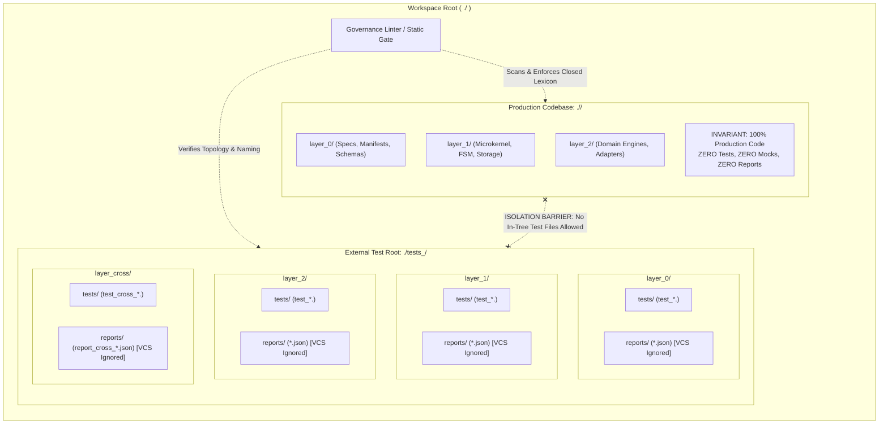

<!-- SPDX-FileCopyrightText: 2026 InsiderCrush -->
<!-- SPDX-License-Identifier: CC-BY-NC-4.0 -->

# ADR-L0-000006. External Test Infrastructure and Sandbox Isolation

## Status
Accepted

## Context
In software architectures driven by autonomous agents and human developers, testing infrastructure frequently becomes a primary source of architectural degradation, non-deterministic CI failures, and static analysis corruption. Without strict physical separation and hermetic isolation invariants, engineering environments encounter five critical failure modes:

1. **The Ouroboros Fault (Static Linter Self-Contamination):**
   When test suites, mock objects, synthetic data fixtures, and test utilities are colocated inside the target project codebase directory (e.g., `./<project_identifier>/tests/`), governance linters and AST analyzers scanning the workspace encounter mock variable names, temporary test classes, and simulated failure payloads. The linter either generates false-positive violations or demands that mock identifiers be registered within the production `./specs/glossary.md` closed vocabulary lexicon. This recursive self-pollution corrupts the ubiquitous language boundary and degrades automated verification gates.

2. **State Leakage Across Execution Boundaries (Dirty Test State):**
   Tests running sequentially or concurrently often mutate shared execution environments—writing to local databases, setting environment variables, persisting files in workspace folders, or modifying global in-memory state. When subsequent tests rely on uninitialized state or encounter dirty residue, tests produce flaky, order-dependent results, masking critical regression defects.

3. **Unconstrained Mocking and Reality Drift (Over-Mocking):**
   Unrestricted mocking of internal subsystem components, business logic functions, or microkernel state machines leads to "green suite illusion." Test suites pass against fabricated internal mocks while production implementations fail under real integration conditions. Furthermore, internal mock definitions drift silently when internal component interfaces evolve.

4. **Test Topology and Artifact Anarchy:**
   Absence of a deterministic structural mirroring between system architectural layers and test suites impedes traceability. Ephemeral test execution artifacts (coverage reports, raw console logs, JSON execution telemetry) inadvertently pollute version control systems (VCS) or trigger false diffs during commit evaluations.

5. **Coupling to Specific Runtime Environments:**
   Hardcoding project-specific or vendor-specific directory paths, custom runner scripts, and environment configurations inside the testing framework prevents the test infrastructure from operating as a decoupled, 100% reusable template for future systems.

To resolve these defects, this standard establishes a mandatory external test root topology, an architectural layer mirroring layout, hermetic sandbox execution policies, outer-boundary mocking rules, and automated static validation gates.

## Decision

### R1. External Test Root Formula (`./tests_<project_identifier>/`)
1. **Mandatory External Root:** All automated test suites, fixtures, test harnesses, mock adapters, and execution reports shall reside in an external root directory strictly adjacent to the project codebase directory, adhering to the canonical formula:
   ```
   ./tests_<project_identifier>/
   ```
2. **In-Tree Test Prohibition:** No test script, test fixture, mock definition, or execution report file shall be created inside the production codebase directory (`./<project_identifier>/`). Any test artifact detected inside the codebase directory triggers an immediate pre-commit and CI build failure (`ERR-L0-000006-1`).
3. **Bundle-Relative Path Invariant:** All paths referencing the test infrastructure in configuration files, test runners, and documentation shall use the bundle-relative prefix `./` (Hermetic Portability Invariant). Absolute paths (e.g., starting with `/` or drive letters) are strictly prohibited.

### R2. System Layer Mirroring Hierarchy & Subdirectory Allocation
1. **Stratified Layer Mirroring:** The external test infrastructure directory shall mirror the system architectural strata defined by the project architecture:
   - `./tests_<project_identifier>/layer_0/` — Standards, meta-documentation, invariant verifiers, and governance linting test suites.
   - `./tests_<project_identifier>/layer_1/` — Foundational runtime, microkernel, finite state machine, and storage ledger test suites.
   - `./tests_<project_identifier>/layer_2/` — Domain engines, external tool adapters, and code fabricators test suites.
   - `./tests_<project_identifier>/layer_cross/` — Cross-cutting systemic integration, end-to-end user journeys, and regression test suites.
2. **Elimination of Legacy Prefixes:** Directory names shall not contain deprecated prefixes (e.g., `CROSS_`). The directory token for cross-strata tests is strictly `layer_cross`.
3. **Rigid Subdirectory Allocation:** Every layer directory shall contain exactly two segregated subdirectories:
   - `tests/` — Allocated exclusively for executable test suites, test cases, and assertion definitions. No execution logs or generated reports may be written to this folder.
   - `reports/` — Allocated exclusively for execution logs, JSON telemetry summaries, and code coverage outputs.
4. **VCS Exclusion Invariant:** All contents within `reports/` subdirectories shall be ignored by Version Control Systems (e.g., via `.gitignore` pattern `**/reports/*`), with empty directory tracking maintained solely via `.gitkeep`.

### R3. Standardized Test and Report Nomenclature Grammar
1. **Test Script Nomenclature:** All test script filenames shall strictly conform to the lowercase snake_case grammar:
   - Layer-Specific Tests: `test_<subsystem>_<feature>.<test_extension>`
   - Cross-Cutting Tests: `test_cross_<subsystem>_<feature>.<test_extension>`
2. **Execution Report Nomenclature:** All generated telemetry and coverage report filenames shall strictly conform to the lowercase snake_case grammar:
   - Layer-Specific Reports: `report_<subsystem>_<feature>.json`
   - Cross-Cutting Reports: `report_cross_<subsystem>_<feature>.json`
3. **Alphabet and Casing:** All file and folder identifiers within the test infrastructure must consist exclusively of lowercase ASCII characters (`[a-z0-9_]`). Non-standard characters, camelCase, PascalCase, and whitespace are strictly prohibited.

### R4. Sandbox Isolation and State Leakage Prevention
1. **Hermetic Test Contexts:** Every test case shall execute within an isolated sandbox context. Test suites shall not rely on side effects produced by preceding tests.
2. **Ephemeral Storage Lifecycles:** Tests requiring filesystem or database interactions shall utilize ephemeral in-memory storage (e.g., SQLite `:memory:`) or dedicated per-test temporary directories created via standard isolation fixtures (e.g., temporary directory fixtures with automatic post-test deletion).
3. **Guaranteed Post-Test Teardown:** Every test fixture creating filesystem entities, thread pools, or network listeners shall implement guaranteed teardown logic to purge all generated artifacts immediately upon test completion, irrespective of pass or fail outcomes.
4. **Deterministic Seed Anchoring:** Any randomized generative test or property-based test must explicitly anchor pseudo-random generator seeds (e.g., `seed=42`) within the test code to ensure 100% deterministic reproducibility across runs.

### R5. Outer-Boundary Mocking Regulations (Anti-Over-Mocking)
1. **Outer-Boundary Restriction:** Test doubles (mocks, stubs, fakes) are strictly restricted to external boundary interfaces (e.g., external third-party HTTP endpoints, system clocks, hardware interfaces, remote messaging transports).
2. **Internal Domain Mocking Prohibition:** Mocking internal domain logic, microkernel state machines, internal storage ledgers, or deterministic calculation engines is strictly prohibited. Internal components must be verified using real implementations.
3. **Contract-Validated Doubles:** Boundary test doubles must be validated against ratified API contracts, schemas, or interface definitions to prevent contract drift between mocks and external services.
4. **Ephemeral Mock Scope:** Mocks must be registered within localized test fixtures and automatically deactivated during teardown, preventing mock behavior from leaking into subsequent test executions.

### R6. Automated Verification Gates and CI Enforcement
1. **Pre-Commit File Location Scanner:** Pre-commit hooks and static linters shall scan all staged and workspace files. Detection of any test or mock file inside `./<project_identifier>/` shall immediately abort execution (`ERR-L0-000006-1`).
2. **Topology and Naming Verifier:** CI gates shall verify that all files under `./tests_<project_identifier>/` comply with the layer mirroring schema and nomenclature rules (`ERR-L0-000006-2`, `ERR-L0-000006-3`).
3. **Leakage and Cleanup Verifier:** Automated test runners shall execute in a clean environment and assert that no untracked files remain in the workspace after test completion (`ERR-L0-000006-4`).

### R7. Bundle-Internal Test Universe (`./tests/`)
1. **Dedicated Bundle Test Root:** The governance bundle shall carry its own test infrastructure in a dedicated root `./tests/` (bundle-relative), located inside the bundle and strictly outside the immutable corpus `./specs/`.
2. **Separate Universe:** `./tests/` constitutes a separate universe with its own laws, its own ADRs, and its own specifications governing test creation; R1–R6 govern host projects, and the bundle test root is the single documented inward instance of the isolation principle.
3. **Corpus Purity:** No test script, fixture, mock, or report file shall be placed inside `./specs/`; any such artifact triggers the in-tree gate (`ERR-L0-000006-1`).
4. **Linter Exclusion:** The main governance linter (zone `./specs/`, non-recursive) shall never scan `./tests/`; test artifacts are verified exclusively under their own universe's laws.
5. **Directionality:** `./specs/` shall never reference `./tests/`; `./tests/` may read `./specs/` as its oracle.

## Structural Topology / Reference Pattern



## Requirements (EARS)

- **REQ-L0-000006-001 (Ubiquitous):**
  The engineering system shall locate all automated test suites, test fixtures, and test execution reports in an external root directory adjacent to the production codebase following the formula `./tests_<project_identifier>/` under error `ERR-L0-000006-2`.
  | Verification: test_external_test_root_location()

- **REQ-L0-000006-002 (Ubiquitous):**
  The test infrastructure shall mirror the system architectural strata using the directory hierarchy `layer_0/`, `layer_1/`, `layer_2/`, and `layer_cross/` under `./tests_<project_identifier>/` under error `ERR-L0-000006-2`.
  | Verification: test_layer_mirroring_hierarchy()

- **REQ-L0-000006-003 (Ubiquitous):**
  The test infrastructure shall divide each layer directory into exactly two segregated subdirectories: `tests/` for executable test scripts and `reports/` for execution outputs under error `ERR-L0-000006-2`.
  | Verification: test_layer_subdirectory_allocation()

- **REQ-L0-000006-004 (Ubiquitous):**
  The test infrastructure shall enforce the naming format `test_<subsystem>_<feature>.<test_extension>` for layer tests and `report_<subsystem>_<feature>.json` for execution reports under error `ERR-L0-000006-3`.
  | Verification: test_artifact_naming_grammar()

- **REQ-L0-000006-005 (Unwanted behaviour):**
  If any test file, fixture script, or mock module is detected inside the production codebase directory `./<project_identifier>/`, then the governance linter shall halt execution with exit code 1 under error `ERR-L0-000006-1`.
  | Verification: test_in_tree_test_detection_gate()

- **REQ-L0-000006-006 (State-driven):**
  While running automated test suites, the test execution harness shall isolate each test execution inside an ephemeral sandbox and delete all generated temporary state upon test completion under error `ERR-L0-000006-4`.
  | Verification: test_sandbox_state_isolation_and_teardown()

- **REQ-L0-000006-007 (Unwanted behaviour):**
  If a test double or mock is applied to internal domain logic, internal microkernel state machines, or internal storage engines, then the verification gate shall reject the test suite under error `ERR-L0-000006-5`.
  | Verification: test_internal_mocking_prohibition_gate()

- **REQ-L0-000006-008 (Event-driven):**
  When a test case executes randomized or property-based test generation, the test runner shall initialize the pseudo-random generator with a deterministic static seed under error `ERR-L0-000006-4`.
  | Verification: test_deterministic_seed_anchoring()

- **REQ-L0-000006-009 (Unwanted behaviour):**
  If any file or directory under `./tests_<project_identifier>/` contains uppercase characters or fails to match the ratified naming grammar, then the static validator shall reject the artifact under error `ERR-L0-000006-3`.
  | Verification: test_test_infrastructure_naming_syntax()

- **REQ-L0-000006-010 (Unwanted behaviour):**
  If any generated test execution report or transient log under `reports/` is tracked or committed to version control, then the repository governance linter shall halt the pre-commit gate under error `ERR-L0-000006-6`.
  | Verification: test_vcs_reports_exclusion_gate()

## Checks & Verification Matrix

| Check Name | Target Artifact | Verification Gate | Error Code | Failure Condition |
| :--- | :--- | :--- | :--- | :--- |
| In-Tree Test Gate | `./<project_identifier>/**/*` | pre-commit / CI | `ERR-L0-000006-1` | Test file, fixture, or mock detected in codebase directory. |
| Test Directory Topology | `./tests_<project_identifier>/*` | pre-commit / CI | `ERR-L0-000006-2` | Missing mandatory layer directories or extra unratified directories. |
| Test & Report Naming | `./tests_<project_identifier>/**/*` | pre-commit / CI | `ERR-L0-000006-3` | File violates lowercase snake_case or canonical prefix conventions. |
| Sandbox State Leak | Workspace root / temp dirs | CI Test Execution | `ERR-L0-000006-4` | Uncleaned temporary files, persistent side-effects, or dirty state leak. |
| Mock Boundary Guard | `./tests_<project_identifier>/**/test_*.<test_extension>` | CI AST Scanner | `ERR-L0-000006-5` | Test double applied to internal domain or microkernel component. |
| VCS Reports Exclusion | `.gitignore`, `reports/` | pre-commit / CI | `ERR-L0-000006-6` | Generated test reports or log files tracked in version control. |

## Error Catalog & Machine Remediation

- **`ERR-L0-000006-1` (OUROBOROS-TEST-IN-TREE-DETECTED):**
  - *Trigger:* A test file, test fixture, mock definition, or test database file is located inside the production codebase `./<project_identifier>/`.
  - *Remediation:* Relocate the test artifact to its corresponding layer subdirectory inside `./tests_<project_identifier>/<layer>/tests/`.
- **`ERR-L0-000006-2` (TEST-DIR-TOPOLOGY-VIOLATION):**
  - *Trigger:* A directory inside `./tests_<project_identifier>/` does not conform to the ratified layer list (`layer_0`, `layer_1`, `layer_2`, `layer_cross`) or lacks the required `tests/` / `reports/` segregation.
  - *Remediation:* Reorganize the directory structure to strictly match `./tests_<project_identifier>/<layer>/[tests|reports]/`.
- **`ERR-L0-000006-3` (TEST-REPORT-NAMING-VIOLATION):**
  - *Trigger:* A filename under `./tests_<project_identifier>/` contains uppercase letters, spaces, or fails to adhere to `test_<subsystem>_<feature>.<test_extension>` or `report_<subsystem>_<feature>.json`.
  - *Remediation:* Rename the file using lowercase ASCII snake_case adhering to the ratified prefix and suffix grammar.
- **`ERR-L0-000006-4` (SANDBOX-STATE-LEAK-DETECTED):**
  - *Trigger:* A test execution leaves uncleaned temporary files, modified environment variables, or mutated persistent records outside its sandbox.
  - *Remediation:* Wrap test resources in automated cleanup fixtures (e.g., standard temporary directory handlers or teardown context managers) and ensure complete post-test state purge.
- **`ERR-L0-000006-5` (INTERNAL-MOCKING-PROHIBITED):**
  - *Trigger:* A mock or monkey-patch is applied to an internal subsystem component, microkernel state machine, or storage engine.
  - *Remediation:* Refactor the test case to use the real internal implementation; restrict test doubles strictly to external boundary interfaces (e.g., external network APIs, system time, or physical peripherals).
- **`ERR-L0-000006-6` (REPORT-DIRECTORY-NOT-IGNORED):**
  - *Trigger:* A generated report or telemetry log file within a `reports/` directory is tracked by version control.
  - *Remediation:* Add `**/reports/*` to `.gitignore` and ensure only `.gitkeep` is tracked.

## Consequences

### Positive
- Completely eliminates linter self-contamination (Ouroboros fault) by isolating test fixtures and mocks from production codebase AST scans.
- Guarantees 100% clean domain vocabulary boundaries in `./specs/glossary.md` without pollution from synthetic test tokens.
- Eliminates flaky, order-dependent test failures through deterministic sandbox isolation and guaranteed teardown.
- Establishes a predictable, machine-verifiable mirroring between architectural layers and test suites.
- Prevents "green suite illusion" by prohibiting over-mocking of internal domain and microkernel components.

### Negative
- Requires test runners, build tools, and CI pipelines to explicitly configure external root paths (`./tests_<project_identifier>/`).
- Demands disciplined test authoring using isolated fixtures and ephemeral resources instead of quick ad-hoc local files.

## Alternatives Considered
- **In-Tree Colocated Tests (`src/__tests__/` or `./<project_identifier>/tests/`):** Rejected. Causes recursive linter self-pollution, lexical boundary corruption in `./specs/glossary.md`, and accidental leakage of test dependencies into production distributions.
- **Flat Unstratified External Directory (`./tests/`):** Rejected. Lacks architectural alignment, obscuring which system stratum a test suite verifies and impeding stratified CI execution pipelines.
- **Unconstrained Deep Mocking:** Rejected. Fosters severe contract drift between mocks and evolving code, creating false confidence while hiding runtime integration failures.
