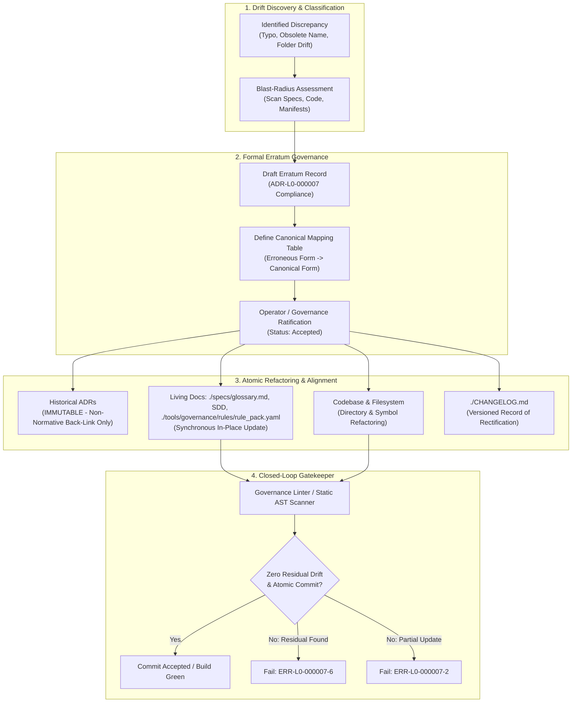

<!-- SPDX-FileCopyrightText: 2026 InsiderCrush -->
<!-- SPDX-License-Identifier: CC-BY-NC-4.0 -->

# ADR-L0-000007. Official Errata and Refactoring Protocols

## Status
Accepted

## Context
In long-lived software systems and multi-agent development environments, software evolution inevitably generates typographical errors, nomenclatural drift, and identifier discrepancies across architectural specifications, codebases, and filesystem trees. These discrepancies emerge from orthographic oversights, organic refactorings, or evolving directory structures.

When such drifts occur, engineering teams encounter four severe structural dilemmas:
1. **Violation of the Immutable Decision History Invariant:**
   Pursuant to `ADR-L0-000001`, ratified Architecture Decision Records (ADRs) are immutable historical artifacts. Mutating an accepted ADR in-place to correct a typo or rename a directory corrupts cryptographic audit trails, invalidates prior verification checksums, and obscures the historical context in which decisions were made.
2. **Nomenclatural Fragmentation and Specification Drift:**
   If typographical and naming discrepancies are ignored or addressed informally in code without updating specifications, the ubiquitous language fractures. Living specifications, schemas, rule manifests, and source code diverge into conflicting dialects, causing cognitive friction for engineers and hallucination loops for autonomous AI agents.
3. **Linter and Static Gate False-Positives / Cascading Blockers:**
   Automated governance linters enforcing closed-vocabulary glossaries and path invariants will flag discrepant or legacy identifiers as critical compliance violations. During refactoring phases, rigid static checkers can generate false alarms or block deployment pipelines unless formal transition and aliasing protocols are defined.
4. **Ad-Hoc Uncontrolled Refactoring Hazards:**
   Refactoring directory names or foundational identifiers across a repository without an explicit, verifiable protocol risks broken import references, lost file history, and orphaned configuration mappings.

To resolve these challenges without compromising ADR immutability or specification integrity, this standard formalizes the official Erratum lifecycle, repository refactoring and legacy drift decontamination procedures, synchronous living document alignment rules, and static analysis transition mechanisms.

## Decision

### R1. Official Erratum Definition and Immutability Preservation
1. **Erratum Classification:** An Erratum is a specialized, formally ratified architectural document (published as a dedicated Erratum record or an amendment decision under Layer 0) that officially rectifies typographical, orthographical, or nomenclatural drift in previously accepted specifications without altering original architectural intent.
2. **Prohibition of In-Place ADR Mutation:** Once an Architecture Decision Record transitions to the `accepted` state, direct in-place edits to its normative text, decision clauses, or historical body are strictly forbidden (`ERR-L0-000007-1`).
3. **Forward-Amending Invariant:** Corrections to accepted ADRs shall be enacted exclusively by publishing a ratified Erratum. The Erratum establishes the authoritative canonical interpretation from the moment of its acceptance forward.
4. **Back-Linking Annotation:** When an Erratum is accepted, the historical target ADR may receive only a non-normative frontmatter update (e.g., adding the Erratum identifier to the `related` metadata array) to ensure bidirectional navigation without altering decision prose.

### R2. Erratum Document Anatomy and Required Metadata
Every Erratum document shall strictly adhere to the standard document format and contain the following mandatory sections:
1. **Frontmatter Metadata:** Must declare `id: ADR-L0-<DocIndex>`, canonical title describing the target rectification, `status: accepted` (or `proposed` during review), `date`, `version`, and explicit references to target documents in `related` and `upstream_adrs`.
2. **Context & Drift Description:** An exact explanation of the identified drift, stating the root cause of the orthographical or nomenclatural discrepancy and its blast radius across the repository.
3. **Canonical Rectification Table:** A formal mapping table explicitly enumerating the invalid/drifted tokens versus their canonical replacements:
   ```markdown
   | Target Artifact / Scope | Erroneous / Legacy Form | Canonical Rectified Form | Drift Type |
   | :--- | :--- | :--- | :--- |
   | `./specs/ADR-L0-000003-unified-taxonomy-naming-rules-and-codebase.md` | `legacy_name_v1` | `canonical_name_v1.0.0` | Typographical |
   ```
4. **Living Documentation Alignment Directive:** Explicit declaration of all living files, schemas, and rule manifests updated synchronously upon erratum ratification.
5. **Consequences:** Clear analysis of system impact, verification gate updates, and elimination of static linter alerts.

### R3. Synchronous Living Artifacts Alignment Protocol (Atomic Update Bundle)
1. **Atomic Synchronization Rule:** Ratification of an Erratum requires immediate, synchronous propagation of all canonical identifiers to all living project artifacts within the exact same commit:
   - Central domain glossary (`./specs/glossary.md` Dual-Key Matrix).
   - Declarative governance rulepacks (`./tools/governance/rules/rule_pack.yaml`).
   - Active Software Design Descriptions (`SDD-*`).
   - Project changelogs (`./CHANGELOG.md`).
   - Configuration files, directory names, and package manifests.
2. **Partial Update Rejection:** Any commit that ratifies an Erratum or modifies a foundational identifier without propagating the change across all registered living documents shall be rejected by the pre-commit gatekeeper (`ERR-L0-000007-2`).

### R4. Canonical Project Identifier and Directory Naming Standard
To eliminate naming ambiguity and prevent directory drift across repository environments:
1. **Canonical Project Identifier Grammar:** Canonical project identifiers and primary root directory names shall conform strictly to lowercase snake_case with semantic versioning:
   ```
   <project_identifier>_v<Major>.<Minor>.<Patch>
   ```
2. **Test Root Mirroring:** The external test infrastructure root shall mirror the canonical identifier pursuant to `ADR-L0-000006`:
   ```
   ./tests_<project_identifier>/
   ```
3. **Bundle-Relative Path Invariant:** All paths recorded in errata, specifications, code, and configurations shall be expressed strictly relative to the bundle root using the prefix `./` (Hermetic Portability Invariant). Absolute paths (e.g., `/home/...` or `C:\...`) are strictly prohibited (`ERR-L0-000007-3`).

### R5. Legacy Drift Refactoring & Repository Decontamination Protocol
When refactoring accumulated legacy drifts (e.g., erroneous folder names, obsolete component prefixes, deprecated aliases), development workflows shall follow a four-stage decontamination pipeline:
1. **Stage 1 (Blast-Radius Discovery & Audit):** Automated AST scanning and text search identify every file, test fixture, configuration line, and specification anchor referencing the legacy token.
2. **Stage 2 (Formal Erratum Drafting):** An Erratum specification is authored, cataloging every affected file and defining the exact canonical replacement.
3. **Stage 3 (Atomic Transformation):** The filesystem entities, code symbols, configuration keys, and living specifications are mutated synchronously in accordance with the Erratum mapping table.
4. **Stage 4 (Closed-Loop Decontamination Gate):** Automated linters verify that zero residual occurrences of the legacy token remain in active living artifacts and codebases before closing the refactoring task (`ERR-L0-000007-6`).

### R6. Static Checker Transition and False-Positive Suppression
1. **Transition Gate Aliasing:** Where an active migration requires multi-step refactoring, the project may register temporary deprecation aliases within `./tools/governance/rules/rule_pack.yaml`. Such aliases must declare a strict expiration threshold (maximum 1 minor release cycle).
2. **Unregistered Alias Rejection:** Any usage of a deprecated or drifted alias not explicitly registered in the active transition gate manifest shall trigger an immediate build failure (`ERR-L0-000007-4`).
3. **Historical ADR Exemption:** Static governance linters scanning the repository shall exclude accepted historical ADR bodies from vocabulary drift failures, provided the historical term is registered in a ratified Erratum mapping table. This prevents false-positive alerts while strictly enforcing closed vocabulary across all active living files.

## Structural Topology / Reference Pattern



## Requirements (EARS)

- **REQ-L0-000007-001 (Ubiquitous):**
  The documentation management system shall rectify typographical, orthographical, and nomenclatural drift in accepted specifications exclusively through formally ratified Erratum documents without mutating historical Architecture Decision Record texts in-place under error `ERR-L0-000007-5`.
  | Verification: test_erratum_lifecycle_and_immutability()

- **REQ-L0-000007-002 (Ubiquitous):**
  The architecture governance engine shall enforce the canonical project identifier and workspace root directory format `<project_identifier>_v<Major>.<Minor>.<Patch>` using strictly lowercase snake_case and ASCII characters under error `ERR-L0-000007-3`.
  | Verification: test_canonical_root_naming_syntax()

- **REQ-L0-000007-003 (Event-driven):**
  When an Erratum is formally ratified into the accepted state, the development workflow shall synchronously propagate all rectified canonical identifiers to `./specs/glossary.md`, `./tools/governance/rules/rule_pack.yaml`, all active Software Design Descriptions, and `./CHANGELOG.md` within a single atomic commit under error `ERR-L0-000007-2`.
  | Verification: test_atomic_living_artifacts_synchronization()

- **REQ-L0-000007-004 (Unwanted behaviour):**
  If an accepted Architecture Decision Record is mutated in-place to correct nomenclatural or typographical drift rather than publishing a forward-amending Erratum, then the governance linter shall halt execution with exit code 1 under error `ERR-L0-000007-1`.
  | Verification: test_adr_in_place_mutation_rejection_gate()

- **REQ-L0-000007-005 (Unwanted behaviour):**
  If an Erratum ratification commit modifies a canonical identifier but fails to update any registered living specification, schema, or rule manifest referencing that identifier, then the pre-commit gatekeeper shall reject the commit under error `ERR-L0-000007-2`.
  | Verification: test_partial_synchronization_detection()

- **REQ-L0-000007-006 (State-driven):**
  While performing legacy repository refactoring and decontamination, the verification harness shall assert zero residual occurrences of the drifted identifier in production code, tests, and active living specifications under error `ERR-L0-000007-6`.
  | Verification: test_residual_legacy_drift_decontamination()

- **REQ-L0-000007-007 (Unwanted behaviour):**
  If any filesystem directory, component path, or workspace reference violates the mandatory relative prefix `./` or contains non-conforming casing, then the static analyzer shall abort execution under error `ERR-L0-000007-3`.
  | Verification: test_workspace_relative_path_invariant()

- **REQ-L0-000007-008 (Optional feature):**
  Where an Erratum defines a temporary migration transition window, the governance linter shall permit registered transition aliases for a period not exceeding 1 minor release cycle while rejecting unregistered aliases under error `ERR-L0-000007-4`.
  | Verification: test_transition_window_alias_validation()

- **REQ-L0-000007-009 (Complex):**
  While static analysis executes during refactoring, When checking historical Architecture Decision Records against the closed vocabulary lexicon, If an apparent discrepancy is registered in a ratified Erratum mapping table, then the governance linter shall suppress false-positive lexical alerts and evaluate compliance against the canonical erratum target under error `ERR-L0-000007-5`.
  | Verification: test_historical_adr_erratum_suppression_gate()

## Checks & Verification Matrix

| Check Name | Target Artifact | Verification Gate | Error Code | Failure Condition |
| :--- | :--- | :--- | :--- | :--- |
| ADR Immutability Guard | `./specs/ADR-*.md` | pre-commit / CI | `ERR-L0-000007-1` | Normative text in an accepted ADR modified directly in-place. |
| Erratum Sync Gate | `./specs/glossary.md`, `./tools/governance/rules/rule_pack.yaml`, `SDD-*` | pre-commit / CI | `ERR-L0-000007-2` | Erratum accepted but living artifacts not updated in atomic commit. |
| Canonical Path Format | Workspace root, directories | pre-commit / CI | `ERR-L0-000007-3` | Non-canonical directory name, absolute path, or invalid casing. |
| Deprecation Alias Check | `./tools/governance/rules/rule_pack.yaml`, source files | CI Static Gate | `ERR-L0-000007-4` | Unregistered deprecated alias or expired transition window alias. |
| Erratum Structure Audit | `./specs/ADR-L0-*.md` | pre-commit / CI | `ERR-L0-000007-5` | Missing mapping table, unmapped drift type, or invalid metadata. |
| Residual Drift Scanner | Entire repository (living scope) | CI Decontamination Gate | `ERR-L0-000007-6` | Legacy or drifted token detected in active codebase or living specs. |

## Error Catalog & Machine Remediation

- **`ERR-L0-000007-1` (IN-PLACE-ADR-MUTATION-PROHIBITED):**
  - *Trigger:* A direct edit to the normative body of an accepted Architecture Decision Record is detected in a commit.
  - *Remediation:* Revert the direct edit to the accepted ADR. Author and submit a new forward-amending Erratum specification in Layer 0 to document the correction.
- **`ERR-L0-000007-2` (ERRATUM-SYNCHRONIZATION-DRIFT):**
  - *Trigger:* An Erratum is accepted or modified, but one or more living artifacts (`./specs/glossary.md`, `./tools/governance/rules/rule_pack.yaml`, `SDD-*`, `./CHANGELOG.md`) remain unsynchronized.
  - *Remediation:* Execute a synchronous update across all living files within the same commit, ensuring that every living reference matches the canonical rectified identifier.
- **`ERR-L0-000007-3` (CANONICAL-NAMING-CONVENTION-VIOLATION):**
  - *Trigger:* A workspace directory, file path, or project root fails to conform to `<project_identifier>_v<Major>.<Minor>.<Patch>` or contains absolute path tokens.
  - *Remediation:* Rename the directory or normalize path references to use strictly lowercase snake_case with bundle-relative `./` prefixes.
- **`ERR-L0-000007-4` (UNREGISTERED-DEPRECATED-ALIAS-DETECTED):**
  - *Trigger:* Source code or specifications use an obsolete alias that is either not registered in `./tools/governance/rules/rule_pack.yaml` or has exceeded its allowed transition window.
  - *Remediation:* Replace the obsolete alias with the canonical rectified term, or update the transition manifest if a valid migration window is actively approved.
- **`ERR-L0-000007-5` (MALFORMED-ERRATUM-STRUCTURE):**
  - *Trigger:* An Erratum document lacks a canonical rectification mapping table, omits upstream document references, or uses non-standard metadata.
  - *Remediation:* Structure the Erratum pursuant to Section R2, including the frontmatter references and the formal Erroneous-to-Canonical mapping table.
- **`ERR-L0-000007-6` (RESIDUAL-LEGACY-DRIFT-DETECTED):**
  - *Trigger:* Residual occurrences of a deprecated identifier or typo remain in active living specifications, schemas, or source files after a refactoring task.
  - *Remediation:* Run a repository-wide search across active living scopes and replace all residual occurrences with the canonical term defined in the Erratum.

## Consequences

### Positive
- Preserves the absolute cryptographic and historical auditability of accepted Architecture Decision Records by preventing retroactive in-place alterations.
- Guarantees seamless, deterministic vocabulary synchronization between specifications, codebases, and rulepacks via atomic update bundles.
- Eliminates false-positive static analyzer and linter failures during active refactoring through explicit Erratum mapping tables and transition aliasing.
- Establishes a predictable, reusable repository decontamination protocol for fixing naming errors, path drifts, and legacy anomalies.
- Provides autonomous AI agents and human developers with a single unambiguous source of truth for canonical system nomenclature.

### Negative
- Requires authoring a formal Erratum record even for minor orthographical or nomenclatural corrections, introducing procedural overhead.
- Demands disciplined multi-file atomic commits when updating foundational identifiers across living artifacts.

## Alternatives Considered
- **Direct In-Place Mutation of Accepted ADRs:** Rejected. Breaks the immutable audit trail of architectural governance, invalidates commit histories, and creates ambiguity regarding when a standard was originally conceived versus when it was corrected.
- **Informal Code-Only Refactoring Without Documentation:** Rejected. Creates silent specification drift, causes ubiquitous language fragmentation, and triggers automated governance linter failures.
- **Permanent Alias Compatibility Shims:** Rejected. Accumulates technical debt, pollutes system vocabulary with permanent duplicates, and increases maintenance cognitive load.
