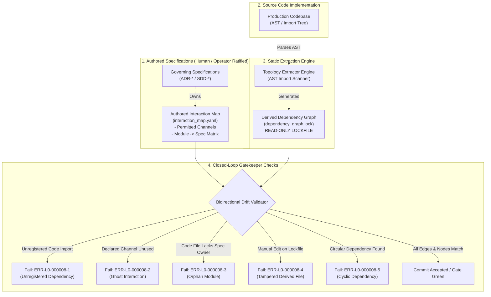

<!-- SPDX-FileCopyrightText: 2026 InsiderCrush -->
<!-- SPDX-License-Identifier: CC-BY-NC-4.0 -->

# ADR-L0-000008. Module Dependency Topology and Interaction Map Standard

## Status
Accepted

## Context
In modular software architectures and AI-assisted development workflows, source code rapidly degrades into unstructured, high-coupling graphs ("spaghetti architecture") if structural module boundaries and communication channels are not rigorously declared, traced, and verified. This architectural degradation manifests through four critical failure modes:
1. **Uncontrolled Structural Coupling and Vibe-Coding Erosion:** Developers and autonomous AI models frequently introduce ad-hoc imports, circular dependencies, or cross-boundary couplings to achieve rapid local functionality ("vibe-coding"), ignoring system layering, interface abstractions, and fault domain boundaries.
2. **Topological Specification Drift:** Written system designs, block diagrams, and interface specifications drift from reality as code evolves. Modules exchange data across undeclared channels while documented interfaces become obsolete, unmaintained, or abandoned.
3. **Orphaned Source Code and Ambiguous Governance Ownership:** Files, packages, or submodules are added to the codebase without being bound to any governing specification, leaving their architectural purpose, contractual constraints, and ownership unmapped.
4. **Manual Documentation Fragility and Lockfile Invalidation:** Maintaining architecture diagrams manually in external tools results in rapid obsolescence. Conversely, treating generated visualization graphs as primary source artifacts leads to untracked merge conflicts and unverified manual tampering.

To eliminate structural drift, enforce clear module ownership, and guarantee deterministic architectural validation, this standard defines:
- The dual-artifact topology model: the authored architectural interaction map and the derived dependency graph.
- The "derived = lockfile" principle governing generated graph artifacts.
- The module-to-specification ownership matrix mapping every code module to a governing specification.
- Automated static gatekeeper algorithms detecting the three canonical forms of topological drift (unregistered dependency, ghost interaction, orphan module) and circular dependencies.

## Decision

### R1. Dual-Artifact Architectural Topology Model
Every software project adhering to this standard shall establish its structural boundaries through two distinct, mathematically verifiable artifacts:
1. **Authored System Interaction Map (`interaction_map.yaml`):**
   - The authoritative, human/operator-ratified declarative specification defining permitted software modules, inter-module communication channels, protocol interfaces, and directionality.
   - Lives as a version-controlled, human-authored structured file; in the governance bundle the canonical location is `./interaction_map.yaml` at the bundle root.
   - Serves as the normative baseline against which actual code imports and dependencies are validated.
2. **Derived Dependency Graph (`dependency_graph.lock` / visual representations):**
   - The programmatically extracted call graph and import hierarchy derived directly from the source code Abstract Syntax Tree (AST).
   - Computed deterministically during pre-commit checks or continuous integration pipelines.
   - Compares 1:1 against the authored interaction map to verify topological compliance.

### R2. The "Derived = Lockfile" Invariant and Modification Protocol
To ensure cryptographic reproducibility and eliminate manual artifact tampering:
1. **Read-Only Lockfile Status:** All derived topology outputs (including machine-readable dependency graphs, adjacency matrices, and rendered visual diagram files such as SVG or Mermaid exports) possess the strict status of a derived lockfile.
2. **Direct Manual Mutation Prohibition:** Direct manual editing of derived topology artifacts is strictly prohibited (`ERR-L0-000008-4`).
3. **Legitimate Mutation Cycle:**
   ```
   [Authored Change: Spec / Code] ──> [Deterministic Generator] ──> [Derived Lockfile Regulated Update]
   ```
   A developer or agent intending to modify system topology shall edit either the authored interaction map or the underlying source code modules, execute the automated graph generator, and commit the regenerated lockfile synchronously.
4. **Static Gate Comparison:** Pre-commit and CI verification shall regenerate the derived graph from the current AST. If the regenerated output differs from the committed lockfile without corresponding source changes, the gatekeeper shall halt with a validation failure.

### R3. Module-to-Specification Ownership Matrix (Structural Traceability)
Every structural component and source code file must possess clear architectural provenance:
1. **Module Specification Mapping Invariant:** The authored interaction map shall maintain an explicit lookup matrix mapping every source code directory, package, or primary module to its governing specification file (`ADR-*` or `SDD-*`) and section identifier.
2. **Orphan Module Prohibition:** Any source code module, service, package, or adapter discovered in the codebase that lacks an explicit mapping to an accepted governing specification is classified as an Orphan Module and rejected (`ERR-L0-000008-3`).
3. **Granularity Requirement:** Module ownership shall be defined at the package or bounded component boundary, declaring:
   - Canonical module identifier (conforming to the taxonomy defined in `ADR-L0-000003`).
   - Relative filesystem location (`./<module_path>`).
   - Governing specification file path (`./specs/.../SDD-...`).
   - Explicit list of permitted outbound dependencies.

### R4. Canonical Topological Drift Classifications
The verification engine shall perform bidirectional AST-to-Map validation and classify deviations into three mutually exclusive failure modes:
1. **Class 1: Unregistered Dependency (Code-to-Map Drift):**
   - *Condition:* Source code module $A$ contains an import, function call, or network binding to module $B$, but the interaction channel $A \to B$ is not declared in the authored interaction map.
   - *Impact:* Architecture boundary violation, unauthorized coupling.
   - *Gate Action:* Immediate build failure under error `ERR-L0-000008-1`.
2. **Class 2: Ghost Interaction (Map-to-Code Drift):**
   - *Condition:* The interaction map declares an active communication channel $A \to B$, but static AST analysis reveals zero imports, references, or invocations from $A$ to $B$ across the codebase.
   - *Impact:* Obsolete documentation, dead architectural intent, false dependency footprint.
   - *Gate Action:* Immediate build failure under error `ERR-L0-000008-2`.
3. **Class 3: Orphan Module (Spec-to-Code Drift):**
   - *Condition:* A source file or directory exists in the codebase but has no entry in the module-to-specification ownership matrix.
   - *Impact:* Unanchored code, unreviewed architectural expansion, vibe-coding leakage.
   - *Gate Action:* Immediate build failure under error `ERR-L0-000008-3`.

### R5. Directed Acyclic Graph (DAG) and Layer Isolation Invariants
To prevent circular coupling and maintain strict architectural layering:
1. **Cycle Detection Invariant:** The interaction map and the derived dependency graph shall form a strict Directed Acyclic Graph (DAG) across subsystem boundaries, unless an explicit cyclic feedback protocol is formally ratified in an accepted ADR.
2. **Acyclic Verification:** Static analysis shall execute cycle detection (e.g., Tarjan's strongly connected components or topological sort) across all declared and detected module edges. Any undetected or unratified circular dependency shall cause immediate gate failure (`ERR-L0-000008-5`).
3. **Layer Boundary Invariant:** Downward-only dependencies: modules residing in higher abstraction layers (e.g., Layer 2 tools) may depend on lower abstraction layers (e.g., Layer 1 kernel or Layer 0 standards), but lower layers shall never import or depend upon higher layers (`ERR-L0-000008-6`).

### R6. Authored Interaction Map Schema
The authored interaction map shall be declared in a canonical format (YAML):
```yaml
schema_version: "1.0.0"
governance_spec: "./specs/ADR-L0-000008-module-dependency-topology-and-interaction-map.md"
modules:
  - id: "module_alpha"
    path: "./src/alpha"
    role: "AlphaEngine"
    owner_spec: "./specs/standards/SDD-L1-<NNNNNN>-<title>.md"
    owner_section: "R2"
    dependencies:
      - target: "module_beta"
        channel: "synchronous_call"
        protocol: "interface_contract"
```

## Structural Topology / Reference Pattern



## Requirements (EARS)

- **REQ-L0-000008-001 (Ubiquitous):**
  The architecture governance engine shall validate repository module dependency topology by performing automated bidirectional comparison between the authored interaction map and the source code Abstract Syntax Tree under error `ERR-L0-000008-1`.
  | Verification: test_topology_bidirectional_validation()

- **REQ-L0-000008-002 (Ubiquitous):**
  The documentation management system shall maintain a module-to-specification ownership matrix mapping every codebase structural module to a governing specification document and section under error `ERR-L0-000008-3`.
  | Verification: test_module_specification_ownership_mapping()

- **REQ-L0-000008-003 (Ubiquitous):**
  The topology generator shall treat all derived dependency graph artifacts and generated visual topology files as read-only lockfiles subject to automated regeneration under error `ERR-L0-000008-4`.
  | Verification: test_derived_topology_lockfile_immutability()

- **REQ-L0-000008-004 (Unwanted behaviour):**
  If an import or interface dependency exists in source code but is not declared within the authored interaction map, then the pre-commit gatekeeper shall reject the change under error `ERR-L0-000008-1`.
  | Verification: test_unregistered_dependency_rejection_gate()

- **REQ-L0-000008-005 (Unwanted behaviour):**
  If the authored interaction map declares an active dependency between modules that does not exist in the source code implementation, then the static verification engine shall flag a ghost interaction and fail execution under error `ERR-L0-000008-2`.
  | Verification: test_ghost_interaction_detection_gate()

- **REQ-L0-000008-006 (Unwanted behaviour):**
  If a source code module or component exists without an explicit ownership entry in the module-to-specification matrix, then the governance linter shall halt execution under error `ERR-L0-000008-3`.
  | Verification: test_orphan_module_detection_gate()

- **REQ-L0-000008-007 (Unwanted behaviour):**
  If a derived topology graph or generated visualization file is manually edited without corresponding changes to authored specification files, then the gatekeeper shall reject the commit under error `ERR-L0-000008-4`.
  | Verification: test_tampered_derived_lockfile_rejection()

- **REQ-L0-000008-008 (Unwanted behaviour):**
  If an unratified circular dependency is introduced between modules in the codebase or interaction map, then the static cycle detector shall abort execution under error `ERR-L0-000008-5`.
  | Verification: test_circular_dependency_detection_gate()

- **REQ-L0-000008-009 (State-driven):**
  While verifying layered architecture compliance, the topology checker shall assert that lower abstraction layers contain zero imports or dependencies targeting higher abstraction layers under error `ERR-L0-000008-6`.
  | Verification: test_layer_inversion_dependency_rejection()

## Checks & Verification Matrix

| Check Name | Target Artifact | Verification Gate | Error Code | Failure Condition |
| :--- | :--- | :--- | :--- | :--- |
| Unregistered Dependency Guard | Source Code AST & `interaction_map.yaml` | pre-commit / CI | `ERR-L0-000008-1` | Code import exists without declaration in interaction map. |
| Ghost Interaction Detector | `interaction_map.yaml` & Source Code AST | pre-commit / CI | `ERR-L0-000008-2` | Declared interaction channel not present in code implementation. |
| Orphan Module Gate | Codebase files & `interaction_map.yaml` | pre-commit / CI | `ERR-L0-000008-3` | Code module lacks mapped governing specification in matrix. |
| Derived Lockfile Guard | `dependency_graph.lock` / visual graphs | pre-commit / CI | `ERR-L0-000008-4` | Derived file modified manually or out of sync with generator. |
| Circular Dependency Detector | Dependency Graph AST | pre-commit / CI | `ERR-L0-000008-5` | Unratified circular dependency cycle detected in graph. |
| Layer Inversion Guard | Module import boundaries | CI Static Gate | `ERR-L0-000008-6` | Lower-layer module depends upon higher-layer component. |

## Error Catalog & Machine Remediation

- **`ERR-L0-000008-1` (UNREGISTERED-DEPENDENCY-DETECTED):**
  - *Trigger:* A source file imports or communicates with another module without an approved dependency declaration in `interaction_map.yaml`.
  - *Remediation:* Remove the unauthorized import from source code, or if architecturally warranted, update `interaction_map.yaml` to authorize the channel and submit for ratification.
- **`ERR-L0-000008-2` (GHOST-INTERACTION-DETECTED):**
  - *Trigger:* `interaction_map.yaml` specifies a dependency channel between modules, but static analysis finds no corresponding call or import in the codebase.
  - *Remediation:* Remove the obsolete interaction channel from `interaction_map.yaml`, or implement the intended integration in code if it was prematurely declared.
- **`ERR-L0-000008-3` (ORPHAN-MODULE-DETECTED):**
  - *Trigger:* A source file or directory exists in the codebase without a registered owner specification in the module-to-specification matrix.
  - *Remediation:* Register the module in `interaction_map.yaml` with its governing specification path (`SDD-*` or `ADR-*`) and section, or delete the unanchored module.
- **`ERR-L0-000008-4` (DERIVED-TOPOLOGY-LOCKFILE-TAMPERED):**
  - *Trigger:* A derived topology graph or lockfile has been edited manually or diverges from the output of the automated extractor.
  - *Remediation:* Revert manual modifications to the derived file and execute the automated topology generator toolchain to synchronize the lockfile with authored sources.
- **`ERR-L0-000008-5` (CIRCULAR-DEPENDENCY-CYCLE-DETECTED):**
  - *Trigger:* A directed cycle of module dependencies is detected during graph analysis.
  - *Remediation:* Refactor the participating modules to break the dependency cycle, extracting shared contracts or using dependency inversion via interfaces.
- **`ERR-L0-000008-6` (LAYER-INVERSION-VIOLATION):**
  - *Trigger:* A module in a lower architectural layer imports or depends on a component residing in a higher layer.
  - *Remediation:* Eliminate the inverted import. Invert the dependency by defining an abstract interface/adapter in the lower layer and implementing it in the higher layer.

## Consequences

### Positive
- Enforces strict architectural boundaries and prevents uncontrolled structural coupling during rapid implementation or AI vibe-coding.
- Guarantees 100% architectural transparency by mapping every single line of source code to a governing specification owner.
- Eliminates "ghost" architectural documentation by automatically identifying and purging unmaintained dependency declarations.
- Establishes a deterministic "derived = lockfile" workflow that eliminates manual synchronization errors in architecture diagrams.
- Prevents spaghetti architectures and circular dependencies through automated DAG enforcement at pre-commit.

### Negative
- Requires updating the authored interaction map whenever legitimate new dependencies between subsystems are introduced.
- Adds static AST parsing steps to pre-commit checks and CI pipelines.

## Alternatives Considered
- **Unchecked Codebase Evolution (Informal Architecture):** Rejected. Leads to rapid structural erosion, spaghetti dependencies, hidden side effects, and loss of ability for autonomous agents to reason about the codebase.
- **Purely Manual Architecture Diagrams:** Rejected. Manual diagrams inevitably drift from reality within weeks and provide no machine-verifiable guarantees at pre-commit.
- **Auto-Generated Architecture Without Authored Baseline:** Rejected. Merely extracting the current code graph reflects what code *does*, not what it *is permitted to do*, failing to catch unauthorized coupling.
