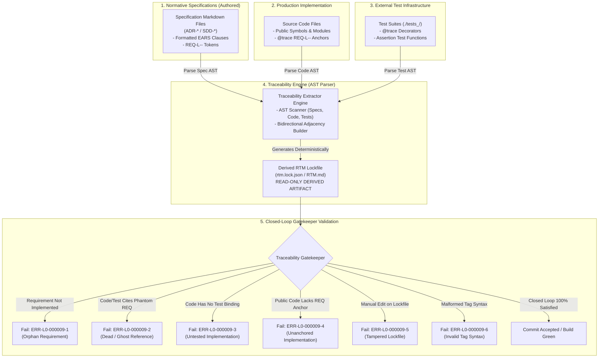

<!-- SPDX-FileCopyrightText: 2026 InsiderCrush -->
<!-- SPDX-License-Identifier: CC-BY-NC-4.0 -->

# ADR-L0-000009. Requirements Traceability Matrix and Closed-Loop Verification

## Status
Accepted

## Context
In rapid iterative engineering and autonomous AI-assisted development environments, software systems suffer from catastrophic semantic degradation when written requirements, production source code, and automated test suites evolve asynchronously ("vibe-coding drift"). This degradation manifests through four distinct failure modes:
1. **Unanchored Production Logic (Vibe-Coding Leakage):** Functional logic, endpoints, or data adapters are introduced directly into the codebase without an authoritative requirement anchor, resulting in undocumented side effects, unreviewed architectural drift, and unmaintainable technical debt.
2. **Orphaned Normative Intent (Dead Specifications):** Requirements are formalized in architectural decision records (ADRs) or software design documents (SDDs) but never implemented in production code or verified by automated tests, creating a false illusion of system completeness.
3. **Ghost Test References (Hallucinated Verification):** Automated test cases assert arbitrary conditions or cite non-existent or deleted requirement identifiers, leaving actual system requirements unverified while generating false-positive green test suites.
4. **Manual Traceability Fragility (Matrix Decay):** Requirements Traceability Matrices (RTMs) maintained as manual tables in spreadsheets or markdown documentation rapidly obsolesce. Developers bypass manual updates, leading to diverging matrices that fail to reflect the true state of the codebase.

To eliminate semantic drift, enforce 100% verifiable implementation, and guarantee deterministic architectural governance, this standard defines:
- The tripartite closed-loop traceability topology (`Specification ↔ Implementation ↔ Verification`).
- The in-file deterministic anchor syntax and AST-based extraction standard.
- The "derived = lockfile" principle governing all generated RTM artifacts.
- The canonical classification of traceability failure modes and automated static gatekeeper algorithms.
- The machine-readable schema for deterministic RTM lockfiles (`rtm.lock.json`).

## Decision

### R1. Tripartite Closed-Loop Traceability Topology
Every software project adhering to this standard shall establish its functional correctness upon a closed-loop tripartite graph:
```
       ┌────────────────────────┐
       │     Specification      │
       │   (ADR-* / SDD-*)      │
       │ REQ-L<Layer>-<DocIndex>-<ItemIndex> │
       └───────────┬────────────┘
                   ▲
         Traces To │ Traced By
                   ▼
┌────────────────────────┐      ┌────────────────────────┐
│     Implementation     │◄────►│      Verification      │
│   (Production Code)    │      │  (External Test Suite) │
│   @trace Annotation    │      │   @trace / Test Name   │
└────────────────────────┘      └────────────────────────┘
```
1. **Closed-Loop Invariant:** A requirement tag `REQ-L<Layer>-<DocIndex>-<ItemIndex>` is classified as `VERIFIED` if and only if:
   - It is declared within an accepted specification document conforming to `ADR-L0-000004` (EARS syntax).
   - It is explicitly referenced by at least one production code AST node or implementation anchor.
   - It is explicitly bound to at least one automated test case in the isolated test root (`./tests_<project>/`).
2. **Bidirectional Completeness:** 
   - Forward Traceability: Every requirement shall trace forward to code and tests.
   - Backward Traceability: Every test case and production code block shall trace backward to a declared requirement.

### R2. In-File Deterministic Anchor Syntax
To ensure zero manual documentation overhead and predictable machine extraction, requirements traceability shall rely entirely on in-file code annotations and specification anchors:
1. **Specification Document Anchor:**
   Requirements shall be declared using canonical EARS syntax as defined in `ADR-L0-000004`:
   ```markdown
   - **REQ-L<Layer>-<DocIndex>-<ItemIndex> (Pattern):**
     The <system> shall <action>.
     | Verification: test_target_name()
   ```
2. **Production Code Anchor:**
   Production source code functions, classes, or interfaces shall declare requirement bindings via standardized docstrings or machine-parseable comments:
   ```
   // Language-neutral docstring or interface annotation
   /**
    * Execute core domain operation.
    * 
    * @trace REQ-L<Layer>-<DocIndex>-<ItemIndex>
    */
   function execute_domain_operation(context: Context): Result
   ```
   Alternatively, for languages lacking docstring introspection, inline boundary comments are permitted:
   ```
   // @trace: REQ-L<Layer>-<DocIndex>-<ItemIndex>
   function execute_domain_operation(context: Context): Result
   ```
3. **Automated Test Suite Anchor:**
   Automated test cases in `./tests_<project>/` shall declare requirement bindings through test runner decorators, annotations, or docstrings:
   ```
   // Language-agnostic test binding decorator or annotation
   @trace("REQ-L<Layer>-<DocIndex>-<ItemIndex>")
   function test_operation_execution(): void {
       // Verification assertion for REQ-L<Layer>-<DocIndex>-<ItemIndex>
       assert(run_operation() === true);
   }
   ```
4. **Anchor Syntax Validation:**
   All requirement tags across specs, code, and tests shall conform strictly to the regex grammar: `^REQ-L[0-3]-\d{6}-\d{3}$`. Any malformed tag causes immediate gatekeeper failure (`ERR-L0-000009-6`).

### R3. The "Derived = Lockfile" Invariant for Traceability Matrices
To ensure cryptographic reproducibility and eliminate manual artifact tampering:
1. **Read-Only Derived Status:** The Requirements Traceability Matrix (`rtm.lock.json` and its rendered markdown view `RTM.md`) is a machine-generated lockfile derived deterministically from the codebase AST and specification anchors.
2. **Manual Mutation Prohibition:** Direct manual editing of `rtm.lock.json` or `RTM.md` is strictly forbidden (`ERR-L0-000009-5`).
3. **Deterministic Regeneration Pipeline:**
   ```
   [Spec / Code / Test Changes] ──> [Traceability Extractor Engine] ──> [Regenerated rtm.lock.json]
   ```
   Whenever specification text, production code, or test scripts are modified, the pre-commit hook or CI pipeline shall execute the static extractor to refresh the lockfile synchronously.
4. **Hash-Based Tamper Detection:** The lockfile shall contain a cryptographic digest of extracted AST nodes. If a committed lockfile diverges from the freshly generated output without corresponding source modifications, the pre-commit gate shall fail closed.

### R4. Canonical Traceability Deviation States & Failure Modes
The verification engine shall perform continuous static graph analysis across all repository artifacts and flag any deviations:
1. **State 1: Orphan Requirement (`ERR-L0-000009-1`):**
   - *Condition:* A requirement tag `REQ-L<Layer>-<DocIndex>-<ItemIndex>` is declared in an accepted specification, but zero production code blocks and zero test functions cite this ID.
   - *Impact:* Specification declared but never implemented or verified; phantom feature.
   - *Gate Action:* Hard build failure.
2. **State 2: Ghost / Dead Reference (`ERR-L0-000009-2`):**
   - *Condition:* A production code block or test case references a requirement ID `REQ-L<Layer>-<DocIndex>-<ItemIndex>` that does not exist in any accepted specification file.
   - *Impact:* Unanchored code, hallucinated requirements, or obsolete tests left behind after specification refactoring.
   - *Gate Action:* Hard build failure.
3. **State 3: Untested Implementation (`ERR-L0-000009-3`):**
   - *Condition:* A requirement tag is referenced in production code, but zero automated test cases in `./tests_<project>/` bind to this requirement ID.
   - *Impact:* Unverified logic, unquantified failure modes, high regression risk.
   - *Gate Action:* Hard build failure.
4. **State 4: Unanchored Implementation (`ERR-L0-000009-4`):**
   - *Condition:* A public production function, class, or service module is introduced without any `@trace` requirement anchor.
   - *Impact:* Vibe-coding expansion; unreviewed logic violating the governance contract.
   - *Gate Action:* Hard build failure during strict pre-commit verification.

### R5. AST-Driven Closed-Loop Verification Pipeline
Traceability validation shall execute via Abstract Syntax Tree (AST) scanning rather than brittle plain-text search:
1. **Specification AST Scanner:** Extracts all `REQ-L<Layer>-<DocIndex>-<ItemIndex>` tokens, requirement patterns, and target test bindings from markdown AST headers and lists.
2. **Source Code AST Scanner:** Scans production modules for decorators, docstring metadata, and symbol declarations, mapping each public symbol to its `@trace` tag.
3. **Test Suite AST Scanner:** Scans `./tests_<project>/` for test functions, decorators (`@trace`), and docstrings to map verified requirement tags.
4. **Execution Budget & SLA:** The traceability validator shall execute deterministically within a latency SLA $\le 1500\text{ ms}$ on repositories containing up to 10,000 lines of code.

### R6. Deterministic RTM Schema Standard
The derived lockfile `rtm.lock.json` shall adhere strictly to the following declarative JSON schema:
```json
{
  "schema_version": "1.0.0",
  "generated_at": "2026-09-29T12:00:00Z",
  "governance_spec": "./specs/ADR-L0-000009-requirements-traceability-matrix-and-closed-loop-verification.md",
  "summary": {
    "total_requirements": 120,
    "verified_count": 120,
    "untested_count": 0,
    "orphan_count": 0,
    "ghost_count": 0,
    "completeness_percentage": 100.0
  },
  "matrix": [
    {
      "requirement_id": "REQ-L0-000009-001",
      "status": "VERIFIED",
      "specification": {
        "file": "./specs/ADR-L0-000009-requirements-traceability-matrix-and-closed-loop-verification.md",
        "line": 142,
        "pattern": "Ubiquitous"
      },
      "implementations": [
        {
          "file": "./src/governance/traceability_engine.<source_extension>",
          "symbol": "<traceability_engine_entrypoint>",
          "line": 45
        }
      ],
      "verifications": [
        {
          "file": "./tests_<project>/layer_0/tests/test_traceability_engine.<test_extension>",
          "function": "test_traceability_bidirectional_extraction",
          "line": 28
        }
      ]
    }
  ]
}
```

## Structural Topology / Reference Pattern



## Requirements (EARS)

- **REQ-L0-000009-001 (Ubiquitous):**
  The traceability engine shall parse specification markdown files, source code abstract syntax trees, and test suite syntax trees to build a bidirectional requirements traceability matrix under error `ERR-L0-000009-1`.
  | Verification: test_traceability_matrix_bidirectional_generation()

- **REQ-L0-000009-002 (Ubiquitous):**
  The traceability generator shall serialize all requirements traceability matrix outputs as read-only derived lockfiles subject to automated regeneration under error `ERR-L0-000009-5`.
  | Verification: test_derived_rtm_lockfile_read_only_status()

- **REQ-L0-000009-003 (Unwanted behaviour):**
  If a requirement identifier declared in an accepted specification has zero corresponding production code anchors or zero test bindings, then the pre-commit gatekeeper shall reject the change under error `ERR-L0-000009-1`.
  | Verification: test_orphan_requirement_rejection_gate()

- **REQ-L0-000009-004 (Unwanted behaviour):**
  If production source code or automated test suites reference a requirement identifier that does not exist in any accepted specification, then the static verification engine shall halt under error `ERR-L0-000009-2`.
  | Verification: test_dead_requirement_reference_rejection_gate()

- **REQ-L0-000009-005 (Unwanted behaviour):**
  If an implementation anchor in production source code lacks an associated automated test binding, then the verification gatekeeper shall fail execution under error `ERR-L0-000009-3`.
  | Verification: test_untested_implementation_rejection_gate()

- **REQ-L0-000009-006 (Unwanted behaviour):**
  If a public production code module or interface is introduced without a valid requirement anchor, then the governance linter shall flag unanchored code and abort under error `ERR-L0-000009-4`.
  | Verification: test_unanchored_implementation_rejection_gate()

- **REQ-L0-000009-007 (Unwanted behaviour):**
  If an RTM lockfile or markdown export is manually edited or diverges from the output of the automated AST extractor, then the gatekeeper shall reject the commit under error `ERR-L0-000009-5`.
  | Verification: test_tampered_rtm_lockfile_rejection_gate()

- **REQ-L0-000009-008 (Unwanted behaviour):**
  If an in-code or test requirement tag fails to match the canonical regular expression format `^REQ-L[0-3]-\d{6}-\d{3}$`, then the parser shall reject the tag under error `ERR-L0-000009-6`.
  | Verification: test_traceability_tag_regex_syntax_validation()

- **REQ-L0-000009-009 (State-driven):**
  While executing pre-commit verification gates, the static traceability engine shall complete full repository AST parsing and matrix validation within a latency SLA $\le 1500\text{ ms}$ for codebases under 10,000 lines of code under error `ERR-L0-000009-7`.
  | Verification: test_traceability_validation_latency_sla()

## Checks & Verification Matrix

| Check Name | Target Artifact | Verification Gate | Error Code | Failure Condition |
| :--- | :--- | :--- | :--- | :--- |
| Orphan Requirement Detector | Specs & Code/Test AST | pre-commit / CI | `ERR-L0-000009-1` | Accepted REQ ID has no code anchor or test binding. |
| Dead Reference Guard | Code AST & Test AST | pre-commit / CI | `ERR-L0-000009-2` | Code or test cites a non-existent REQ ID. |
| Untested Logic Gate | Production Code AST & Test AST | pre-commit / CI | `ERR-L0-000009-3` | Implemented requirement has zero automated tests. |
| Unanchored Code Guard | Production Code AST | pre-commit / CI | `ERR-L0-000009-4` | Public function or module lacks `@trace` requirement anchor. |
| Tampered RTM Lockfile Guard | `rtm.lock.json` / `RTM.md` | pre-commit / CI | `ERR-L0-000009-5` | Derived RTM lockfile was modified manually. |
| Tag Syntax Linter | In-file markdown & AST tags | pre-commit / CI | `ERR-L0-000009-6` | Requirement tag fails regex `^REQ-L[0-3]-\d{6}-\d{3}$`. |
| Traceability Performance SLA Guard | Static AST parser | pre-commit / CI | `ERR-L0-000009-7` | Full AST validation latency exceeds SLA <= 1500 ms. |

## Error Catalog & Machine Remediation

- **`ERR-L0-000009-1` (ORPHAN-REQUIREMENT-DETECTED):**
  - *Trigger:* A requirement tag declared in an accepted ADR or SDD has no matching `@trace` in production code or verification test.
  - *Remediation:* Implement the missing functional logic and bind it to an automated test case, or if the requirement was discarded, formally deprecate/supersede the specification.
- **`ERR-L0-000009-2` (DEAD-REQUIREMENT-REFERENCE-DETECTED):**
  - *Trigger:* Production code or an automated test contains an `@trace` anchor citing a requirement ID that does not exist in any accepted specification.
  - *Remediation:* Verify the requirement ID against the canonical range in the governing specification. Either correct the typo in the anchor or remove obsolete references to deleted requirements.
- **`ERR-L0-000009-3` (UNTESTED-IMPLEMENTATION-DETECTED):**
  - *Trigger:* A production code block anchors to a requirement ID, but no test case in `./tests_<project>/` binds to that requirement.
  - *Remediation:* Author an automated unit or integration test binding to the requirement ID via `@trace("REQ-L<Layer>-<DocIndex>-<ItemIndex>")` in `./tests_<project>/`.
- **`ERR-L0-000009-4` (UNANCHORED-IMPLEMENTATION-DETECTED):**
  - *Trigger:* A public module, class, or function is committed without an associated `@trace` requirement anchor.
  - *Remediation:* Bind the functional code to its governing requirement using `@trace REQ-L<Layer>-<DocIndex>-<ItemIndex>` in the docstring, or register a new requirement via formal specification update if creating new behavior.
- **`ERR-L0-000009-5` (DERIVED-RTM-LOCKFILE-TAMPERED):**
  - *Trigger:* The derived file `rtm.lock.json` or `RTM.md` has been manually modified or is out of sync with the codebase AST.
  - *Remediation:* Revert manual modifications to the derived lockfile and execute the automated traceability extraction toolchain to synchronize the lockfile with source code.
- **`ERR-L0-000009-6` (INVALID-REQUIREMENT-TAG-SYNTAX):**
  - *Trigger:* A requirement tag in specifications, code, or tests fails to match the regular expression `^REQ-L[0-3]-\d{6}-\d{3}$`.
  - *Remediation:* Correct the requirement tag formatting to conform to the 3-tier canonical standard (e.g., `REQ-L0-000009-001`).
- **`ERR-L0-000009-7` (TRACEABILITY-SLA-BREACH):**
  - *Trigger:* Static AST extraction and RTM validation latency exceeds maximum bounded limit of 1500 ms.
  - *Remediation:* Optimize AST parsing, enable incremental caching, or index requirement symbols to restore compliant latency.

## Consequences

### Positive
- Enforces 100% bidirectional closed-loop verification, preventing vibe-coding drift and untested production logic.
- Eliminates phantom requirements and obsolete test cases through automated AST cross-referencing.
- Eradicates manual documentation overhead by generating read-only RTM lockfiles deterministically from in-file anchors.
- Provides immediate pre-commit feedback with machine-actionable remediation instructions for developers and autonomous agents.
- Guarantees complete architectural visibility across the full lifecycle from intent to verification.

### Negative
- Requires maintaining in-file `@trace` annotations across all public production functions and test cases.
- Introduces AST parsing overhead into pre-commit and CI verification pipelines (budgeted $\le 1500\text{ ms}$).

## Alternatives Considered
- **Manual Spreadsheet or Markdown RTMs:** Rejected. Manual matrices diverge from reality within days, require immense human upkeep, and offer zero pre-commit validation.
- **Purely Forward-Only Traceability (Spec to Code):** Rejected. Forward-only tracing fails to detect unanchored production code (vibe-coding leakage) and ghost test cases.
- **Unverified Requirement Binding (Name Matching):** Rejected. Relying on heuristic text search or function name matching without strict regex anchors creates false positives and breaks refactoring tools.
