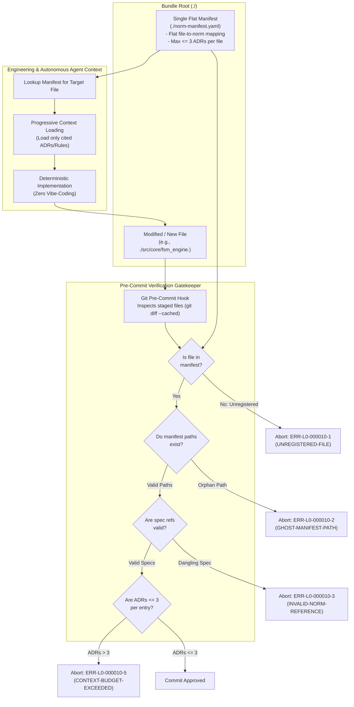

<!-- SPDX-FileCopyrightText: 2026 InsiderCrush -->
<!-- SPDX-License-Identifier: CC-BY-NC-4.0 -->

# ADR-L0-000010. Norm Applicability Manifest and File Registration Gate

## Status
Accepted

## Context
In modern software engineering involving autonomous AI agents and human developers, codebase evolution is acutely prone to "vibe-coding" drift—the practice of authoring or altering source code, configuration files, and schemas without prior consultation of governing architectural contracts, specifications, or security boundaries. This dysfunction is compounded by two fundamental constraints:
1. **Context Window Saturation & Degradation:** A complete system specification suite contains tens or hundreds of architectural decision records (ADRs), software design documents (SDDs), and domain constraints. Injecting the entire documentation corpus into an AI model's context window exceeds token budgets, triggers "Lost-in-the-Middle" attention collapse, and increases generation latency and cost.
2. **Unanchored File Creation & Semantic Blindness:** In the absence of an explicit linkage mechanism between repository file paths and their governing standards, engineers and AI models modify code in isolation, inadvertently violating naming conventions, state machine invariants, error handling protocols, or architectural boundary rules.
3. **Hierarchical Index Failure:** Empirical benchmarks demonstrate that multi-tiered, nested, or per-directory documentation indexes degrade retrieval accuracy substantially (dropping from 0.91 to 0.64 in hierarchical indexing, whereas a single flat index maintains precision at 0.46 compared to 0.26 for raw unstructured navigation). Multi-level indexing creates navigation friction, broken symbolic links, and synchronization overhead.

To enforce deterministic architectural compliance, guarantee progressive context disclosure, and eliminate unanchored code generation, this standard establishes:
- The specification of a single, flat repository norm applicability manifest (`./norm-manifest.yaml` / `./norm-manifest.json`).
- The direct mapping linking repository file paths to authoritative governing rules and specification anchors.
- The `UNREGISTERED-FILE` pre-commit gatekeeper, halting any commit attempting to modify or introduce unmapped files.
- The context economy constraint enforcing an upper ceiling of $\le 3$ normative ADRs per typical engineering task.

## Decision

### R1. Single Flat Repository Manifest Standard
Every software repository conforming to this architecture shall maintain exactly one central norm applicability manifest located at the bundle root (`./norm-manifest.yaml` or `./norm-manifest.json`):
1. **Root-Level Locality Invariant:** The manifest file shall reside strictly in the bundle root directory: `./norm-manifest.yaml`.
2. **Prohibition of Hierarchical / Split Manifests:** Subdirectory manifests, nested indexes, per-package rule manifests, or fragmented configuration files are strictly forbidden (`ERR-L0-000010-4`). A single flat index ensures $O(1)$ lookups, prevents split-brain rule resolution, and avoids navigational decay during automated repository traversal.
3. **Completeness Invariant:** Every file tracked by version control—including source code modules, configuration manifests, infrastructure scripts, and documentation files—shall be explicitly mapped in the root manifest.

### R2. Direct File-to-Norm Mapping and Progressive Context Disclosure
The root manifest provides an authoritative lookup table (`File Path ↔ Applicable Norms`) that enables progressive context disclosure:
1. **Target File Addressing:** Entries in the manifest shall specify repository paths using bundle-relative path notation (`./...`) or deterministic glob patterns (e.g., `./src/adapters/*.<source_extension>`, `./specs/*.md`).
2. **Rule Binding Syntax:** Each entry shall enumerate:
   - Primary governing specification documents (`specs`: list of ADR or SDD identifiers/paths).
   - Specific rule selectors (`rules`: list of specific rule tags, e.g., `ADR-L0-000003/R2`, `ADR-L0-000005/R1`).
   - Operational context description and primary component role suffix.
3. **Pre-Execution Progressive Disclosure:** Before modifying any file $F$, the execution agent (human or AI) shall query the manifest for $F$, retrieve only the explicitly declared governing rules, and load exclusively that minimal rule subset into working memory.

### R3. Pre-Commit "UNREGISTERED-FILE" Gatekeeper
To prevent vibe-coding leakage and unanchored mutations, a strict pre-commit verification gatekeeper is established:
1. **Gatekeeper Interception:** The pre-commit gatekeeper shall inspect the Git index staging area for all added (`A`), modified (`M`), or renamed (`R`) files.
2. **Registration Verification:** For every staged file path $P$, the gatekeeper shall verify whether $P$ matches at least one registered path or glob pattern in `./norm-manifest.yaml`.
3. **Fail-Closed Execution:** If any staged file is absent from the manifest, the gatekeeper shall immediately abort the commit with error code `ERR-L0-000010-1` (`UNREGISTERED-FILE-DETECTED`), emitting a structured remediation directive.
4. **Zero-Bypass Policy:** No source file, test fixture, or build script may bypass the registration gate. Modifications to `./norm-manifest.yaml` must accompany the introduction of any new file within the same atomic commit.

### R4. Context Economy Budget Invariant ($\le 3$ ADR Rule)
To prevent cognitive overload and attention degradation:
1. **Upper Context Bound:** The manifest mapping for any single file pattern shall not require the simultaneous loading of more than three ($\le 3$) normative architectural decision records (`ERR-L0-000010-5`).
2. **Modularity Enforcement:** If a file mapping legitimately requires four or more ADRs to execute an atomic edit, this condition signals excessive architectural coupling and domain contamination, requiring component decomposition or rule consolidation.

### R5. Ghost Path and Broken Reference Elimination
To prevent manifest staleness and phantom configurations:
1. **Ghost Path Detection:** Every path or pattern declared in the manifest must resolve to at least one active, existing file in the repository tree. If a registered path points to a non-existent file, the static linter shall fail under `ERR-L0-000010-2` (`GHOST-MANIFEST-PATH-DETECTED`).
2. **Normative Reference Integrity:** Every document or rule selector cited in the `specs` or `rules` fields must resolve to an accepted specification document in `./specs/`. Dangling or misspelled specification links trigger `ERR-L0-000010-3` (`INVALID-NORM-REFERENCE-DETECTED`).

### R6. Deterministic Manifest Schema Standard
The `./norm-manifest.yaml` file shall conform strictly to the following declarative schema:
```yaml
schema_version: "1.0.0"
repository_root: "./"
manifest_type: "flat"

rules_registry:
  ADR-L0-000003: "./specs/ADR-L0-000003-unified-taxonomy-naming-rules-and-codebase.md"
  ADR-L0-000005: "./specs/ADR-L0-000005-fsm-grammar-syntax-and-registry.md"
  ADR-L0-000009: "./specs/ADR-L0-000009-requirements-traceability-matrix-and-closed-loop-verification.md"
  ADR-L0-000010: "./specs/ADR-L0-000010-norm-applicability-manifest-and-file-registration-gate.md"

entries:
  - path: "./specs/*.md"
    description: "Normative Layer 0 architectural decision records and standards"
    specs:
      - "ADR-L0-000001"
      - "ADR-L0-000002"
      - "ADR-L0-000004"
    rules:
      - "ADR-L0-000001/R1"
      - "ADR-L0-000004/R2"

  - path: "./src/core/fsm_engine.<source_extension>"
    description: "Finite state machine execution core"
    specs:
      - "ADR-L0-000003"
      - "ADR-L0-000005"
      - "ADR-L0-000009"
    rules:
      - "ADR-L0-000003/R1"
      - "ADR-L0-000005/R1"
      - "ADR-L0-000009/R2"

  - path: "./tests_<project>/layer_0/tests/*.<test_extension>"
    description: "External test infrastructure verification scripts"
    specs:
      - "ADR-L0-000006"
      - "ADR-L0-000009"
    rules:
      - "ADR-L0-000006/R1"
      - "ADR-L0-000009/R3"
```

## Structural Topology / Reference Pattern



## Requirements (EARS)

- **REQ-L0-000010-001 (Ubiquitous):**
  The manifest gatekeeper shall maintain and validate a single flat file registration manifest located at the bundle root `./norm-manifest.yaml` under error `ERR-L0-000010-4`.
  | Verification: test_norm_manifest_root_existence_and_structure()

- **REQ-L0-000010-002 (Ubiquitous):**
  The manifest engine shall resolve the governing specification documents and rule selectors for any requested repository file path through deterministic single-level pattern matching under error `ERR-L0-000010-3`.
  | Verification: test_norm_manifest_rule_resolution()

- **REQ-L0-000010-003 (Unwanted behaviour):**
  If any added, modified, or staged repository file is not explicitly registered in `./norm-manifest.yaml`, then the pre-commit gatekeeper shall abort execution under error `ERR-L0-000010-1`.
  | Verification: test_unregistered_file_commit_gate_block()

- **REQ-L0-000010-004 (Unwanted behaviour):**
  If `./norm-manifest.yaml` contains file paths or glob patterns that do not resolve to any physical file in the repository, then the manifest validator shall halt under error `ERR-L0-000010-2`.
  | Verification: test_ghost_manifest_path_rejection()

- **REQ-L0-000010-005 (Unwanted behaviour):**
  If a manifest entry references a specification identifier or rule selector that does not exist in the accepted specifications registry, then the validation gatekeeper shall abort under error `ERR-L0-000010-3`.
  | Verification: test_invalid_norm_reference_rejection()

- **REQ-L0-000010-006 (Unwanted behaviour):**
  If a secondary, nested, or hierarchical manifest file is detected within any subdirectory of the repository, then the repository structure scanner shall fail under error `ERR-L0-000010-4`.
  | Verification: test_hierarchical_manifest_rejection()

- **REQ-L0-000010-007 (Unwanted behaviour):**
  If any manifest entry binds more than three normative architectural decision records to a single file pattern, then the context budget analyzer shall abort under error `ERR-L0-000010-5`.
  | Verification: test_context_budget_ceiling_enforcement()

- **REQ-L0-000010-008 (State-driven):**
  While executing pre-commit verification gates, the manifest gatekeeper shall complete full staging area file registration validation within a latency SLA $\le 500\text{ ms}$ for repositories up to 5,000 files under error `ERR-L0-000010-6`.
  | Verification: test_manifest_validation_latency_sla()

## Checks & Verification Matrix

| Check Name | Target Artifact | Verification Gate | Error Code | Failure Condition |
| :--- | :--- | :--- | :--- | :--- |
| Unregistered File Guard | Git Index / Staged Files | pre-commit / CI | `ERR-L0-000010-1` | Staged file has no matching entry in `./norm-manifest.yaml`. |
| Ghost Path Detector | `./norm-manifest.yaml` & File Tree | pre-commit / CI | `ERR-L0-000010-2` | Manifest declares a path/pattern with zero existing files. |
| Norm Reference Guard | `./norm-manifest.yaml` & `./specs/` | pre-commit / CI | `ERR-L0-000010-3` | Manifest references non-existent ADR/SDD or rule tag. |
| Flat Manifest Topology Guard | Repository Subdirectories | pre-commit / CI | `ERR-L0-000010-4` | Nested or per-directory manifest file detected. |
| Context Budget Guard | `./norm-manifest.yaml` | pre-commit / CI | `ERR-L0-000010-5` | File entry references $> 3$ normative ADR documents. |
| Manifest Performance SLA Guard | Manifest gatekeeper | pre-commit / CI | `ERR-L0-000010-6` | Full manifest validation latency exceeds SLA <= 500 ms. |

## Error Catalog & Machine Remediation

- **`ERR-L0-000010-1` (UNREGISTERED-FILE-DETECTED):**
  - *Trigger:* A new or modified file is committed without an explicit entry or matching glob pattern in `./norm-manifest.yaml`.
  - *Remediation:* Register the file in `./norm-manifest.yaml` under `entries:`, declaring its governing specification documents (`specs`) and rule tags (`rules`), then re-stage the manifest.
- **`ERR-L0-000010-2` (GHOST-MANIFEST-PATH-DETECTED):**
  - *Trigger:* An entry in `./norm-manifest.yaml` targets a file path or glob pattern that matches zero files in the repository.
  - *Remediation:* Remove the obsolete entry from `./norm-manifest.yaml` if the target file was deleted or renamed, or correct the typographical error in the path definition.
- **`ERR-L0-000010-3` (INVALID-NORM-REFERENCE-DETECTED):**
  - *Trigger:* A manifest entry references a specification document or rule selector that does not exist in `./specs/`.
  - *Remediation:* Check the canonical specification ID in `./specs/` and update the `specs` or `rules` list to cite a valid, accepted specification anchor.
- **`ERR-L0-000010-4` (HIERARCHICAL-MANIFEST-PROHIBITED):**
  - *Trigger:* A manifest file (e.g., `./norm-manifest.yaml`, `rules.yaml`) is discovered inside a subdirectory rather than the bundle root.
  - *Remediation:* Delete the nested manifest and consolidate all file mappings into the single central `./norm-manifest.yaml` at bundle root.
- **`ERR-L0-000010-5` (CONTEXT-BUDGET-EXCEEDED):**
  - *Trigger:* A file entry binds more than 3 normative ADR documents in its `specs` array.
  - *Remediation:* Refactor the target component to decouple responsibilities, or consolidate overlapping governance rules so that the file requires $\le 3$ ADRs to modify.
- **`ERR-L0-000010-6` (MANIFEST-VALIDATION-SLA-BREACH):**
  - *Trigger:* Pre-commit staging area validation latency exceeds the 500 ms threshold.
  - *Remediation:* Optimize glob matching patterns, reduce unnecessary disk IO, or cache manifest rules.

## Consequences

### Positive
- Enforces an unbreakable pre-commit boundary against "vibe-coding" and unanchored codebase alterations.
- Guarantees progressive context disclosure for AI agents and human developers, reducing LLM token consumption and preventing lost-in-the-middle context degradation.
- Prevents multi-level navigation decay and broken references by enforcing a single flat manifest architecture.
- Automates detection of abandoned files, ghost paths, and dangling specification links at pre-commit time.
- Imposes an explicit structural ceiling ($\le 3$ ADRs per file) on architectural complexity and coupling.

### Negative
- Requires maintaining the central `./norm-manifest.yaml` when adding or deleting files.
- Introduces pre-commit validation overhead (budgeted $\le 500\text{ ms}$).

## Alternatives Considered
- **Nested / Per-Directory Manifests:** Rejected. Experiments and production data reveal that hierarchical manifests degrade context retrieval accuracy (0.91 $\to$ 0.64), add multi-directory sync friction, and complicate pre-commit validation.
- **Dynamic AI-Driven Rule Guessing:** Rejected. Relying on an LLM to dynamically guess which rules apply to a file produces hallucinated boundaries, non-deterministic enforcement, and zero pre-commit blocking capabilities.
- **Ad-Hoc Manual Documentation Browsing:** Rejected. Leaving rule consultation to manual developer discretion inevitably leads to vibe-coding, silent architectural drift, and non-compliant code generation.
