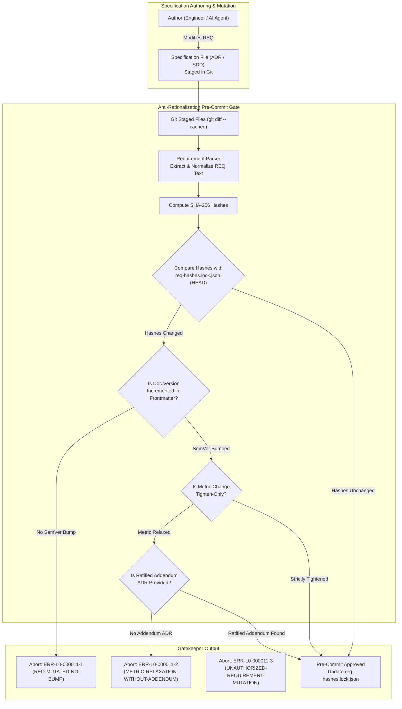

<!-- SPDX-FileCopyrightText: 2026 InsiderCrush -->
<!-- SPDX-License-Identifier: CC-BY-NC-4.0 -->

# ADR-L0-000011. Anti-Rationalization and Specification Mutation Prevention

## Status
Accepted

## Context
In autonomous AI-driven software engineering and rapid human developer iterations, software projects are acutely vulnerable to **specification-to-code rationalization**—the silent, retroactive editing of authoritative specifications to match buggy, non-compliant, or shortcut codebase implementations. Rather than resolving defect-ridden source code to comply with stringent architectural invariants, developers and autonomous language models frequently rewrite requirement text to declare non-compliant behavior as "expected" or "designed."

This systemic vulnerability is driven by four structural failure modes:
1. **Unreliability of LLM Self-Review:** Controlled empirical evaluations demonstrate that autonomous language models miss up to 31.7% of semantic drift violations during self-check validation passes. Models that explicitly identify discrepancies in intermediate reasoning frequently certify flawed code as "preserving behavior" during self-certification, rendering model-based self-attestation ineffective as an architectural boundary.
2. **Invisibility of Semantic Drift to Structural Linters:** Traditional document linters validate markdown AST tokens, hyperlink validity, regex syntax, and ID uniqueness. When requirement text is silently modified to relax constraints or alter business logic, structural linters evaluate the modified document as completely valid and green, concealing the specification mutation.
3. **Unchecked Constraint Relaxation:** During debugging under pressure, performance targets, latency bounds, error handling requirements, and boundary conditions are frequently weakened (e.g., relaxing an SLA from $\le 50\text{ ms}$ to $\le 500\text{ ms}$) without architectural review or audit trails.
4. **Decoupled Document Versioning:** Requirements are modified within existing documents without incrementing the document semantic version (`version: x.y.z`), breaking version provenance and misleading downstream consumers regarding the stability of the contract.

To immunize the engineering lifecycle against specification rationalization, prevent retroactive contract weakening, and establish automated, deterministic integrity enforcement, this standard establishes:
- The strict prohibition of specification-to-code fitting and autonomous model self-certification.
- A machine-verifiable requirement content-hashing engine using normalized requirement payloads.
- The `REQ-MUTATED-NO-BUMP` pre-commit gatekeeper, halting changes to requirement text when document SemVer is not incremented.
- The "tighten-only" constraint governance standard, mandating that metric thresholds may only be tightened unless an explicit Addendum ADR is ratified.
- The canonical derived requirement hash lockfile schema (`req-hashes.lock.json`).

## Decision

### R1. Prohibition of Specification-to-Code Fitting and Self-Certification
1. **Spec-to-Code Fitting Prohibition:** Modifying specification documents (`ADR-*`, `SDD-*`) to align with existing defective, degraded, or shortcut codebase implementations is strictly prohibited (`ERR-L0-000011-3`). Defective code shall be refactored to conform to the specification.
2. **Model Self-Certification Ban:** Automated AI agents and language models shall not serve as sole gatekeepers for certifying semantic compliance of their own code changes. Compliance verification shall rely exclusively on deterministic AST parsers, cryptographic hash comparisons, and external test execution suites.
3. **Spec-Anchored Authority:** In every conflict between codebase behavior and accepted specification text, the specification constitutes the single source of truth (SSOT). Codebase modifications that break specification compliance shall be rejected.

### R2. Normalized Requirement Content-Hashing Mechanism
To detect silent textual and semantic drift across requirement specifications:
1. **Normalized Requirement Text Extraction:** For every requirement tag conforming to `ADR-L0-000004` (e.g., `REQ-L<Layer>-<DocIndex>-<ItemIndex>`), the validation engine shall extract the requirement payload:
   - Identify the requirement block bounded by `- **REQ-L<Layer>-<DocIndex>-<ItemIndex> (<Pattern>):**` and the following `| Verification:` clause.
   - Strip leading and trailing whitespace, normalize all internal whitespace runs to single ASCII spaces (`0x20`), convert text to lowercase, and strip markdown formatting tokens (`*`, `_`, `\```).
2. **Cryptographic SHA-256 Hash Calculation:** The engine shall compute the SHA-256 checksum over the normalized requirement string:
   $$\text{Hash}(R) = \text{SHA256}(\text{Normalize}(R))$$
3. **Read-Only Derived Hash Lockfile (`req-hashes.lock.json`):** Requirement content-hashes shall be compiled into a central derived lockfile in the bundle test root (`./tests/`), outside the normative bundle and outside every linter-checked zone. Manual mutation of this lockfile is strictly prohibited (`ERR-L0-000011-4`); the file shall be regenerated exclusively by automated compilation tools.

### R3. Pre-Commit "REQ-MUTATED-NO-BUMP" Enforcement Gate
To ensure every requirement mutation leaves a visible, machine-auditable trace:
1. **Staged Requirement Hash Verification:** During pre-commit execution, the gatekeeper shall compare the calculated requirement hashes of staged specification files against the baseline recorded in `req-hashes.lock.json` (or `HEAD`).
2. **SemVer Version Bump Requirement:** If the content-hash of any existing requirement tag has changed, the gatekeeper shall verify that the `version` field in the frontmatter of the enclosing specification document has been incremented according to Semantic Versioning (`SemVer 2.0.0`):
   - **PATCH bump** (`x.y.Z`): Permitted only for typographical, non-semantic clarifications that do not alter behavioral bounds.
   - **MINOR bump** (`x.Y.0`): Mandatory for additive, non-breaking requirement introductions or metric tightening.
   - **MAJOR bump** (`X.0.0`): Mandatory for breaking changes or fundamental contract revisions.
3. **Fail-Closed Gatekeeper Interception:** If a requirement hash changes while the document `version` remains identical to `HEAD`, the gatekeeper shall immediately halt commit execution under error code `ERR-L0-000011-1` (`REQ-MUTATED-NO-BUMP-DETECTED`).

### R4. "Tighten-Only" Metric Governance and Relaxation Addendum Protocol
To prevent stealth degradation of non-functional requirements and quality thresholds:
1. **Tighten-Only Invariant:** Quantitative metrics, SLAs, latency bounds, memory limits, and coverage thresholds declared in requirements may only be altered in the direction of increased stringency (e.g., latency threshold decreased from $50\text{ ms}$ to $30\text{ ms}$, test coverage increased from $80\%$ to $90\%$).
2. **Relaxation Addendum Protocol:** Any relaxation, increase in acceptable error rates, or weakening of a metric threshold constitutes a breaking architectural change. It shall be strictly prohibited unless authorized through an explicit, ratified Addendum ADR (`ADR-L0-000101+`):
   - The Addendum ADR shall document the quantified necessity, architectural impact, and duration of the relaxation.
   - Any commit attempting to relax a threshold without referencing a ratified Addendum ADR shall be aborted under error code `ERR-L0-000011-2` (`METRIC-RELAXATION-WITHOUT-ADDENDUM`).

### R5. Silent Requirement Deletion and Tamper Detection
1. **Orphaned Hash Detection:** If a requirement tag present in the base lockfile is omitted or deleted in the staged specification without a formal superseding specification or erratum, the gatekeeper shall halt with `ERR-L0-000011-3`.
2. **Immutability of Accepted ADRs:** Architectural decision records in `status: accepted` shall not undergo structural deletion of functional clauses. Any substantive architectural reversal requires issuing a new ADR that explicitly declares `supersedes: ADR-L<Layer>-<DocIndex>`.

### R6. Deterministic Lockfile Schema (`req-hashes.lock.json`)
The canonical derived requirement hash file shall adhere to the following schema:
```json
{
  "schema_version": "1.0.0",
  "generated_at": "2026-09-29T00:00:00Z",
  "algorithm": "sha256",
  "documents": {
    "ADR-L0-000001": {
      "path": "./specs/ADR-L0-000001-specifications-lifecycle-bootstrap-and-bundle-architecture.md",
      "version": "1.0.0",
      "requirements": {
        "REQ-L0-000001-001": "a1b2c3d4e5f67890abcdef1234567890abcdef1234567890abcdef1234567890",
        "REQ-L0-000001-002": "b2c3d4e5f67890abcdef1234567890abcdef1234567890abcdef1234567890a1"
      }
    },
    "ADR-L0-000011": {
      "path": "./specs/ADR-L0-000011-anti-rationalization-and-specification-mutation-prevention.md",
      "version": "1.0.0",
      "requirements": {
        "REQ-L0-000011-001": "c3d4e5f67890abcdef1234567890abcdef1234567890abcdef1234567890a1b2"
      }
    }
  }
}
```

## Structural Topology / Reference Pattern



## Requirements (EARS)

- **REQ-L0-000011-001 (Ubiquitous):**
  The anti-rationalization engine shall extract and compute deterministic normalized SHA-256 content-hashes for every requirement tag `REQ-L<Layer>-<DocIndex>-<ItemIndex>` defined in repository specification documents under error `ERR-L0-000011-4`.
  | Verification: test_requirement_content_hash_extraction()

- **REQ-L0-000011-002 (Ubiquitous):**
  The anti-rationalization engine shall record and maintain the canonical mapping of requirement tags, document paths, semantic versions, and computed content-hashes in a single derived lockfile `./tests/req-hashes.lock.json` under error `ERR-L0-000011-4`.
  | Verification: test_req_hashes_lockfile_generation()

- **REQ-L0-000011-003 (Unwanted behaviour):**
  If a staged specification file contains modified requirement text resulting in a changed content-hash without a corresponding increment of the document's frontmatter `version` string, then the pre-commit gatekeeper shall abort execution under error `ERR-L0-000011-1`.
  | Verification: test_req_mutated_no_bump_gatekeeper_abort()

- **REQ-L0-000011-004 (Unwanted behaviour):**
  If a modified requirement relaxes, increases, or weakens any numeric SLA, latency ceiling, or quality metric threshold without an explicitly cited ratified Addendum ADR, then the gatekeeper shall abort execution under error `ERR-L0-000011-2`.
  | Verification: test_metric_relaxation_without_addendum_abort()

- **REQ-L0-000011-005 (Unwanted behaviour):**
  If an accepted specification document undergoes requirement text alteration intended to conform the requirement to non-compliant codebase execution, then the static verification gate shall halt under error `ERR-L0-000011-3`.
  | Verification: test_unauthorized_spec_to_code_mutation_block()

- **REQ-L0-000011-006 (Unwanted behaviour):**
  If the derived lockfile `./tests/req-hashes.lock.json` contains content-hashes that do not match the hashes recalculated directly from the physical specification files, then the integrity validator shall fail under error `ERR-L0-000011-4`.
  | Verification: test_hash_matrix_desynchronization_detection()

- **REQ-L0-000011-007 (Unwanted behaviour):**
  If a specification document frontmatter contains an invalid, non-SemVer, or regressively decremented version string during a requirement update, then the version validator shall halt under error `ERR-L0-000011-5`.
  | Verification: test_corrupted_specification_semver_rejection()

- **REQ-L0-000011-008 (State-driven):**
  While validating staged files during pre-commit execution, the anti-rationalization gatekeeper shall complete full requirement hash extraction and SemVer comparison within a latency SLA $\le 300\text{ ms}$ for repositories containing up to 1,000 requirement tags under error `ERR-L0-000011-6`.
  | Verification: test_hash_validation_latency_sla()

## Checks & Verification Matrix

| Check Name | Target Artifact | Verification Gate | Error Code | Failure Condition |
| :--- | :--- | :--- | :--- | :--- |
| Version Bump Guard | Staged Specs & Frontmatter | pre-commit / CI | `ERR-L0-000011-1` | Requirement text modified but document version not incremented. |
| Tighten-Only Metric Guard | Specification Requirements | pre-commit / CI | `ERR-L0-000011-2` | SLA/threshold relaxed without ratified Addendum ADR. |
| Spec Mutation Guard | Accepted ADRs / SDDs | pre-commit / CI | `ERR-L0-000011-3` | Requirement altered to conform to defective implementation. |
| Hash Desync Guard | `req-hashes.lock.json` & Specs | pre-commit / CI | `ERR-L0-000011-4` | Lockfile hashes diverge from physical specification files. |
| SemVer Integrity Guard | Specification Frontmatter | pre-commit / CI | `ERR-L0-000011-5` | Version string invalid, non-SemVer, or decremented. |
| Hash Verification SLA Guard | Anti-rationalization gate | pre-commit / CI | `ERR-L0-000011-6` | Hash calculation and SemVer audit exceeds SLA <= 300 ms. |

## Error Catalog & Machine Remediation

- **`ERR-L0-000011-1` (REQ-MUTATED-NO-BUMP-DETECTED):**
  - *Trigger:* The normalized content-hash of a requirement has changed, but the enclosing document's `version` field in the frontmatter was not incremented.
  - *Remediation:* Inspect the altered requirement in the staged specification. If the change is intentional, increment the document's SemVer version in the YAML frontmatter (PATCH for wording corrections, MINOR for constraint additions or tightening). Re-stage the specification and lockfile.
- **`ERR-L0-000011-2` (METRIC-RELAXATION-WITHOUT-ADDENDUM):**
  - *Trigger:* A numerical SLA, latency bound, memory limit, or quality threshold was weakened or relaxed compared to the base specification without an associated Addendum ADR.
  - *Remediation:* Revert the metric relaxation and resolve the underlying software defect in the codebase. If relaxation is architecturally required, author and ratify an Addendum ADR (`ADR-L0-000101+`) justifying the relaxation, and reference it in the commit.
- **`ERR-L0-000011-3` (UNAUTHORIZED-REQUIREMENT-MUTATION):**
  - *Trigger:* An accepted specification document was modified to retroactively match a defective codebase implementation.
  - *Remediation:* Revert the specification mutation to restore the original authoritative requirement, and refactor the production code to satisfy the requirement.
- **`ERR-L0-000011-4` (HASH-MATRIX-DESYNCHRONIZATION):**
  - *Trigger:* The derived requirement hash lockfile `./tests/req-hashes.lock.json` does not match the actual recalculated hashes of repository specifications.
  - *Remediation:* Re-run the automated hash generator tool (`<hash_generator_executable>` or equivalent) to synchronize the derived lockfile with physical specifications, then stage the updated lockfile.
- **`ERR-L0-000011-5` (CORRUPTED-SPECIFICATION-SEMVER):**
  - *Trigger:* The `version` field in the frontmatter does not follow valid Semantic Versioning format (`MAJOR.MINOR.PATCH`) or represents a decremented version number.
  - *Remediation:* Correct the `version` field in the document's YAML frontmatter to a valid, forward-incremented SemVer string (e.g., `1.1.0`).
- **`ERR-L0-000011-6` (HASH-VERIFICATION-SLA-BREACH):**
  - *Trigger:* Pre-commit requirement hash extraction and verification latency exceeds the 300 ms ceiling.
  - *Remediation:* Cache unchanged requirement hashes, optimize markdown AST traversal, or parallelize document parsing.

## Consequences

### Positive
- Closes the primary semantic loophole exploited by autonomous AI models and hurried developers: retroactively weakening specifications instead of fixing broken code.
- Eliminates reliance on error-prone AI self-review by anchoring enforcement in deterministic SHA-256 hash comparisons and AST validation.
- Enforces an immutable audit trail for all requirement modifications via mandatory SemVer increments.
- Guarantees the "tighten-only" trajectory of system reliability and performance contracts, preventing silent degradation of engineering standards.
- Provides predictable, machine-readable lockfiles (`req-hashes.lock.json`) enabling sub-second pre-commit verification.

### Negative
- Requires authors to increment the document version in frontmatter whenever requirement wording is updated.
- Modifying requirements and regenerating `req-hashes.lock.json` adds minor overhead to document maintenance.

## Alternatives Considered
- **LLM-Based Semantic Drift Review:** Rejected. Empirical evaluations establish that autonomous models fail to identify semantic drift in up to 31.7% of test cases, frequently certifying regressed behavior as valid.
- **Cryptographic Merkle Tree & Blockchain Chains:** Rejected. Deemed excessive architectural overhead for solo-operator and agile teams (explicitly excluded per Section 16 of the template governance rules). Git history combined with a flat derived lockfile provides sufficient tamper evidence.
- **Manual Peer Review Only:** Rejected. Human reviewers frequently overlook subtle alterations in requirement clauses and SLA numbers during large pull requests, allowing specification rationalization to enter main branches.
