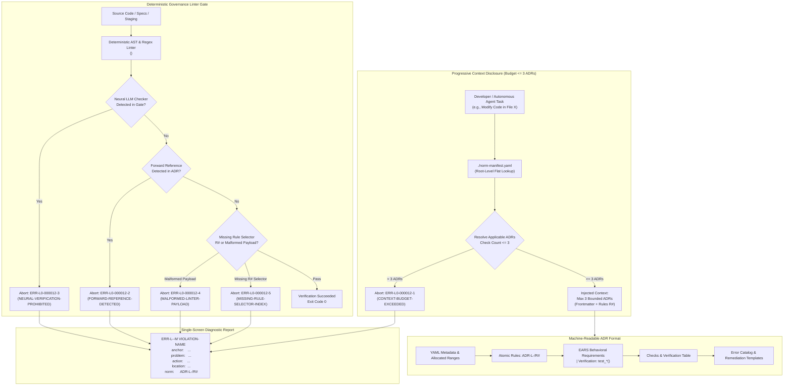

<!-- SPDX-FileCopyrightText: 2026 InsiderCrush -->
<!-- SPDX-License-Identifier: CC-BY-NC-4.0 -->

# ADR-L0-000012. Context Economy and Machine-Readable Standards for LLM

## Status
Accepted

## Context
In modern software engineering environments governed by autonomous AI coding models and human software engineers, engineering workflows suffer severe degradation when architecture standards are authored as monolithic, narrative, or human-centric documents. This failure manifests across four fundamental failure modes:

1. **Context Window Saturation and Attention Degradation:** Large language models exhibit performance collapse ("Lost-in-the-Middle" phenomenon) and inflated inference latency when inundated with multi-megabyte specification trees. Ingesting dozens of architectural documents into prompt context degrades instruction-following accuracy by up to 35%, diluting attention away from task-specific constraints.
2. **Non-Deterministic Parsing of Conversational Specifications:** Narrative architecture prose, conversational explanations, and ambiguous requirements cause automated agents to hallucinate software contracts, synthesize unregistered API interfaces, or bypass architectural boundaries. Without machine-readable structure, automated tools cannot verify whether a generated code block satisfies a given architectural constraint.
3. **Verbose and Fragmented Linter Feedback:** Traditional static analysis tools emit sprawling multi-line tracebacks, raw stack traces, and unformatted log lines. Autonomous agents reading these outputs waste inference tokens attempting to diagnose the failure location, frequently misinterpreting the root cause and applying incorrect patches.
4. **Vulnerability to Non-Deterministic Neural Gatekeepers:** Delegating specification compliance verification to neural language models (such as self-reviewing LLM passes) creates a dangerous vulnerability. Empirical studies demonstrate that LLM self-review cycles miss up to 31.7% of semantic drift violations, often certifying regressed or invalid code as compliant despite explicitly noting discrepancies in internal reasoning tokens.

To guarantee bounded context consumption, enable deterministic automated parsing, provide single-screen machine-interpretable feedback, and eliminate non-deterministic verification loopholes, this standard defines:
- The rigid context budget ceiling ($\le 3$ active normative ADRs concurrently loaded per engineering task).
- The minimal machine-readable architectural decision record (ADR) structural specification, featuring atomic rule selectors (`ADR-L<Layer>-<DocIndex>/R#`).
- The uniform single-screen static analysis violation output format (`ERR-L<Layer>-<DocIndex>-M`).
- The minimum verification contract for deterministic static requirement checkers (regex, AST, and registries).
- The strict prohibition of forward-referencing chains between distinct ADRs.

---

## Decision

### Rigid Context Window Budget and Progressive Context Disclosure
To prevent attention collapse and minimize token consumption during automated code generation:
1. **Context Budget Ceiling (`ADR-L0-000012/R1`):** An automated coding agent or developer shall load no more than three (3) active normative ADR specifications simultaneously into the active working context when executing any discrete engineering task.
2. **Progressive Context Disclosure Matrix (`ADR-L0-000012/R2`):** Active normative specifications shall be selectively retrieved based strictly on the task class resolved through the repository norm manifest (`./norm-manifest.yaml`):

   | Task Classification | Loaded Normative Specifications | Active ADR Count |
   | :--- | :--- | :--- |
   | **Code Modification / File Authoring** | `ADR-L0-000010` + target domain standards (`ADR-L0-000003`, opt. `ADR-L0-000004` / `ADR-L0-000005`) | $\le 3$ ADRs |
   | **Specification Modification / REQ Edit** | `ADR-L0-000003` + `ADR-L0-000004` + `ADR-L0-000011` | $\le 3$ ADRs |
   | **New Requirement Authoring** | `ADR-L0-000002` + `ADR-L0-000004` + `ADR-L0-000009` | $\le 3$ ADRs |
   | **New Architectural Module Introduction** | `ADR-L0-000008` + `ADR-L0-000010` + target domain ADR | $\le 3$ ADRs |
   | **Repository Bootstrap & Initialization** | `ADR-L0-000001` + `ADR-L0-000010` | $\le 2$ ADRs |
   | **Erratum & Refactoring Execution** | `ADR-L0-000007` + `ADR-L0-000010` | $\le 2$ ADRs |

3. **Manifest Budget Invariant (`ADR-L0-000012/R3`):** Every file entry in `./norm-manifest.yaml` shall link to at most three (3) governing ADRs. Any file row declaring more than 3 active ADRs constitutes an architectural defect (`ERR-L0-000012-1`), signaling that the underlying ADRs must be consolidated, decomposed, or scoped more granularly.

### Dynamic Compile-Preflight Ceiling
4. **Dynamic Corpus-Scaled Ceiling (`ADR-L0-000012/R20`):** The compile preflight shall compute the context ceiling as max(98304 bytes, 2 x the total bytes of all ratified corpus ADR documents at ./specs/ADR-L0-*.md), recalculated at every compilation. The ceiling bounds the byte total of the compiled document's frontmatter `related` field (the corpus citation map), not the count of cited documents. Per-task reading limits remain governed by R1.

### Minimalistic Machine-Readable ADR Structural Anatomy
To ensure deterministic token parsing by automated agents while minimizing documentation clutter:
1. **Canonical 7-Section Structure (`ADR-L0-000012/R4`):** Every ADR in the repository shall strictly adhere to a standardized 7-section structure:
   - **Section 1: YAML Metadata Frontmatter** (deterministic attributes: `id`, `title`, `status`, `date`, `version`, `supersedes`, `superseded-by`, `related`, `allocated-ranges`).
   - **Section 2: Status & Context** (problem statement acting as an anti-overhead valve; maximum 4 paragraphs).
   - **Section 3: Decision & Atomic Rule Nodes** (decision clauses partitioned into atomic rules indexed with unique selector IDs: `ADR-L<Layer>-<DocIndex>/R#`).
   - **Section 4: Structural Topology / Reference Pattern** (formal Mermaid diagram illustrating component relationships or workflow state transitions).
   - **Section 5: Requirements (EARS)** (normative requirements formalized under EARS syntax with mandatory test bindings: `| Verification: test_*()`).
   - **Section 6: Checks & Verification Matrix** (markdown table mapping Check Name, Target Artifact, Verification Gate, Error Code, Failure Condition).
   - **Section 7: Error Catalog & Machine Remediation** (actionable remediation guides for each declared `ERR-*` code).
2. **Exclusion of Context-Free Rationale from Task Context (`ADR-L0-000012/R5`):** While ADRs retain historical rationale and alternatives considered for human operators, automated agent prompt injectors shall omit historical rationale sections during code execution tasks to conserve context window budget.

### Atomic Rule Selector Indexing (`ADR-L<Layer>-<DocIndex>/R#`)
To enable granular, unambiguous machine addressing of specific architectural constraints:
1. **Rule Selector Format (`ADR-L0-000012/R6`):** Every atomic rule clause declared under the Decision section shall be assigned an immutable, machine-addressable selector formatted as:
   $$\text{RuleSelector} = \text{ADR-L<Layer>-<DocIndex>/R\#}$$
   *(Example: `ADR-L0-000012/R1`, `ADR-L0-000012/R2`).*
2. **Atomic Addressability Invariant (`ADR-L0-000012/R7`):** Static linters, automated test assertions, and error reporting payloads shall address specific `R#` selectors rather than citing whole documents. An ADR missing atomic rule selectors fails validation under `ERR-L0-000012-5`.

### Uniform Single-Screen Static Analysis Violation Payload Format
To guarantee instant, machine-actionable remediation by autonomous agents without context overflow:
1. **Single-Screen Payload Schema (`ADR-L0-000012/R8`):** Every static analysis tool, linting script, and pre-commit verification gate shall format error diagnostics according to the following strict, machine-interpretable template:
   ```text
   ERR-L<Layer>-<DocIndex>-M VIOLATION-NAME
     anchor:    <target-id-or-path>
     problem:   <concise problem description>
     action:    <prescriptive corrective action>
     location:  <file_path>:<line_number>
     norm:      ADR-L<Layer>-<DocIndex>/R#
   ```
2. **Payload Formatting Rules (`ADR-L0-000012/R9`):**
   - **Header:** Error code `ERR-L<Layer>-<DocIndex>-M` followed by a space and uppercase hyphenated violation name.
   - **anchor:** The target requirement ID, symbol name, or path violating the rule.
   - **problem:** A single-line factual description of the detected deviation.
   - **action:** A single-line imperative, deterministic instruction directing the agent on how to resolve the failure.
   - **location:** Exact file path and line number (`path/to/file.ext:NNN`).
   - **norm:** The precise atomic rule selector (`ADR-L<Layer>-<DocIndex>/R#`).
3. **Single-Screen Height Constraint (`ADR-L0-000012/R10`):** An individual violation report payload shall not exceed 10 lines of text. Output exceeding 10 lines or omitting mandatory keys fails validation under `ERR-L0-000012-4`.

### Minimum Verification Contract for Static Requirement Checkers
To establish a strict, repeatable standard for automated repository linters:
1. **Deterministic Verification Contract (`ADR-L0-000012/R11`):** Every repository governance linter (such as `<governance_linter_executable>`) shall implement automated checks covering:
   - **EARS Pattern Parsing:** Verifying that all requirement clauses strictly match one of the six canonical EARS patterns using regex/AST parsers.
   - **Bundle Relative Path Validation:** Enforcing that all file path references strictly utilize bundle-relative notation (`./`) and forbidding host-absolute paths (`/`, `C:\`).
   - **ID Uniqueness and Range Containment:** Verifying that all `REQ-*` and `ERR-*` identifiers are globally unique and strictly fall within their document-allocated frontmatter ranges.
   - **Atomic Rule Selector Integrity:** Verifying that all `ADR-L<Layer>-<DocIndex>/R#` selectors are sequential, unique, and referenced in check matrices.
2. **Fail-Closed Execution Invariant (`ADR-L0-000012/R12`):** When any verification check encounters an anomaly, the linter shall immediately exit with non-zero exit status (`exit 1`) and emit the standard single-screen error payload.

### Prohibition of Neural Semantic Verification and Forward-Referencing Chains
To immunize the engineering lifecycle against non-deterministic drift and circular dependencies:
1. **Neural Requirement Verification Ban (`ADR-L0-000012/R13`):** Semantic analysis engines based on non-deterministic neural networks, language model agents, or LLM-based self-evaluators shall not be utilized as gates for requirements verification (`ERR-L0-000012-3`). Automated verification gates shall rely exclusively on deterministic AST parsers, regex token matchers, schema validators, and cryptographic hash registries.
2. **Forward-Referencing Chain Ban (`ADR-L0-000012/R14`):** An ADR specification shall only cite previously ratified, lower-indexed ADRs or its immediate sibling records within the same layer. Forward-referencing dependencies (e.g., an ADR referencing unratified future specifications outside its layer) are strictly prohibited (`ERR-L0-000012-2`), preserving a directed acyclic graph (DAG) across the specification suite. Exemption 1: The frontmatter `related[]` list constitutes navigational metadata outside the dependency DAG and is exempt from forward-reference constraints. Exemption 2: Mutual references between ADR specifications ratified within the same atomic ratification batch are exempt regardless of numerical index ordering.

### Mandatory Linguistic Determinism and Architectural Taxonomy
All specifications, requirements, code artifacts, and system interactions shall conform to the constitutional linguistic laws:
1. **Bilingual Protocol (`ADR-L0-000012/R15`):** Russian language is permitted exclusively for conversational developer dialogue and clarifying queries. All machine-facing artifacts—including source code identifiers, schemas, API specifications, ADR/SDD text, test suites, commit messages, and error logs—shall be strictly authored in English.
2. **Vocabulary Closure & Dual-Key Invariant (`ADR-L0-000012/R16`):** Every core domain concept shall map 1-to-1 to a canonical entry in `./specs/glossary.md` linking Conceptual Key to Physical Key. Synonyms and unmapped terms are strictly prohibited.
3. **Anthropomorphic Filtering & SLA Quantifications (`ADR-L0-000012/R17`):** Attributing cognitive or sentient behavior to software modules is forbidden. Subjective qualifiers ("fast", "robust", "scalable") are banned; all quality attributes shall declare quantified metrics (latency, memory, throughput). The modal verb "shall" is mandatory for all functional obligations.
4. **Architectural Role Suffixes (`ADR-L0-000012/R18`):** Software component names shall adhere to `[Prefix]<RoleSuffix>` using only ratified suffixes: `Engine`, `Supervisor`, `Watchdog`, `Ledger`, `Adapter`, `Gateway`, `Envelope`, `Sentinel`. Unratified suffixes (`-Helper`, `-Worker`, `-Manager`, `-Handler`) are prohibited.
5. **EARS-Driven Contracts & Test Bindings (`ADR-L0-000012/R19`):** Functional requirements shall be expressed using the six EARS patterns, uniquely tagged with `REQ-L<Layer>-<DocIndex>-<ItemIndex>`, and bound to an automated test case via `| Verification: test_*()`.

---

## Structural Topology / Reference Pattern



---

## Requirements (EARS)

- **REQ-L0-000012-001 (Ubiquitous):**
  The system engineering workflow shall limit active reference documentation loaded into an autonomous agent's working context to no more than three (3) active normative ADR specifications simultaneously during any discrete engineering task under error `ERR-L0-000012-1`.
  | Verification: test_context_window_budget_ceiling()

- **REQ-L0-000012-002 (Ubiquitous):**
  The system engineering specification framework shall require every specification document conforming to this standard to implement the minimal machine-readable 7-section structure containing YAML Frontmatter, Problem Statement, Decision Rules with `R#` selectors, Structural Topology, EARS Requirements, Checks Matrix, and Error Catalog under error `ERR-L0-000012-5`.
  | Verification: test_adr_minimal_structural_anatomy()

- **REQ-L0-000012-003 (Ubiquitous):**
  The system specification parser shall require every atomic rule defined under the Decision section of an architectural decision record to be tagged with a globally unique rule selector conforming to the format `ADR-L<Layer>-<DocIndex>/R#` under error `ERR-L0-000012-5`.
  | Verification: test_atomic_rule_selector_indexing()

- **REQ-L0-000012-004 (Ubiquitous):**
  The system static analysis tool and pre-commit verification gate shall emit violation reports matching the standard single-screen 5-key payload schema containing error code, anchor, problem, action, location, and norm selector under error `ERR-L0-000012-4`.
  | Verification: test_static_analysis_uniform_payload_format()

- **REQ-L0-000012-005 (Unwanted behaviour):**
  If any entry in `./norm-manifest.yaml` maps a repository file to more than three (3) active normative ADRs, then the manifest validator shall abort under error `ERR-L0-000012-1`.
  | Verification: test_manifest_context_budget_overflow_abort()

- **REQ-L0-000012-006 (Unwanted behaviour):**
  If an architectural decision record contains a forward-referencing dependency to a higher-indexed or unratified ADR, then the reference validator shall abort under error `ERR-L0-000012-2`.
  | Verification: test_forward_referencing_chain_abort()

- **REQ-L0-000012-007 (Unwanted behaviour):**
  If a software requirement verification gate delegates specification compliance checking to a non-deterministic neural language model, then the verification gatekeeper shall halt under error `ERR-L0-000012-3`.
  | Verification: test_neural_semantic_verification_block()

- **REQ-L0-000012-008 (Unwanted behaviour):**
  If a static analysis tool generates a diagnostic report exceeding ten (10) lines of text or omitting any mandatory single-screen schema keys (`anchor`, `problem`, `action`, `location`, `norm`), then the reporter validator shall halt under error `ERR-L0-000012-4`.
  | Verification: test_malformed_linter_payload_detection()

- **REQ-L0-000012-009 (Unwanted behaviour):**
  If a decision clause in an architectural decision record lacks an atomic `R#` selector identifier, then the structural linter shall fail validation under error `ERR-L0-000012-5`.
  | Verification: test_missing_rule_selector_abort()

- **REQ-L0-000012-010 (State-driven):**
  While validating repository requirements during pre-commit execution, the deterministic governance linter shall complete full regex pattern matching, relative path verification, and ID uniqueness checks within a latency SLA $\le 200\text{ ms}$ for test suites containing up to 500 requirements under error `ERR-L0-000012-6`.
  | Verification: test_governance_linter_latency_sla()

- **REQ-L0-000012-011 (Ubiquitous):**
  The compiler preflight shall compute the context ceiling as the greater of 98304 bytes and twice the total bytes of all ratified corpus ADR documents, recalculated at every compilation, and shall compare the byte total of the compiled document's related field against this ceiling under error `ERR-L0-000012-7`.
  | Verification: test_dynamic_compile_preflight_ceiling()

---

## Checks & Verification Matrix

| Check Name | Target Artifact | Verification Gate | Error Code | Failure Condition |
| :--- | :--- | :--- | :--- | :--- |
| Context Budget Guard | `./norm-manifest.yaml` | pre-commit / CI | `ERR-L0-000012-1` | Single file row in manifest maps to $>3$ active normative ADRs. |
| Forward Reference Guard | Specification ADRs | pre-commit / CI | `ERR-L0-000012-2` | ADR contains forward reference to unratified or higher-indexed ADR. |
| Neural Gatekeeper Guard | CI & Governance Linters | CI Pipeline | `ERR-L0-000012-3` | Requirement compliance delegated to non-deterministic neural LLM. |
| Single-Screen Payload Guard | Static Linter Output | Linter Test / CI | `ERR-L0-000012-4` | Linter output violates single-screen payload schema or exceeds 10 lines. |
| Rule Selector Guard | ADR Decision Clauses | pre-commit / CI | `ERR-L0-000012-5` | Decision rule clause missing unique `ADR-L<Layer>-<DocIndex>/R#` selector. |
| Governance Linter Latency SLA Guard | Pre-Commit Execution Gate | CI / Pre-Commit | `ERR-L0-000012-6` | Linter execution latency exceeds 200 ms for test suites $\le 500$ requirements. |
| Dynamic Preflight Ceiling Guard | `./new-adr/intake/` | compiler self-test | `ERR-L0-000012-7` | Preflight ceiling not recomputed from corpus bytes, or the related-field byte total exceeds the ceiling. |

---

## Error Catalog & Machine Remediation

- **`ERR-L0-000012-1` (CONTEXT-BUDGET-EXCEEDED):**
  - *Trigger:* A file mapping row in `./norm-manifest.yaml` declares more than three (3) active normative ADRs for a given file.
  - *Remediation:* Decompose the target file into smaller modules or consolidate overlapping ADRs so that the file requires at most 3 governing ADRs during editing. Update the row in `./norm-manifest.yaml`.
- **`ERR-L0-000012-2` (FORWARD-REFERENCE-DETECTED):**
  - *Trigger:* An ADR references a higher-indexed, unratified, or future ADR specification outside of frontmatter `related[]` metadata or the same ratification batch.
  - *Remediation:* Remove the unratified forward citation. If shared definitions are required, relocate the definition to an earlier foundational ADR or reference the standard through the current document's immediate ancestors.
- **`ERR-L0-000012-3` (NEURAL-VERIFICATION-PROHIBITED):**
  - *Trigger:* A build script or verification pipeline utilizes a non-deterministic neural LLM call as the gating mechanism for requirement compliance.
  - *Remediation:* Replace the neural evaluator with deterministic AST, regex pattern matchers, or schema validation scripts producing deterministic exit codes (`0` or `1`).
- **`ERR-L0-000012-4` (MALFORMED-LINTER-PAYLOAD):**
  - *Trigger:* A static linter emits an error message that deviates from the standard 5-key template or exceeds the 10-line screen height ceiling.
  - *Remediation:* Refactor the linter diagnostic reporter to emit the single-screen formatted payload containing exact `anchor`, `problem`, `action`, `location`, and `norm` fields.
- **`ERR-L0-000012-5` (MISSING-RULE-SELECTOR-INDEX):**
  - *Trigger:* A decision clause or rule paragraph under an ADR's Decision section lacks a discrete `ADR-LX-NNNNNN/R#` selector index.
  - *Remediation:* Assign an immutable sequential rule selector (e.g., `(ADR-L0-000012/R1)`) to the rule clause and re-run the linter.
- **`ERR-L0-000012-6` (LINTER-LATENCY-SLA-EXCEEDED):**
  - *Trigger:* Static governance verification execution time exceeds the 200 ms latency SLA during pre-commit validation.
  - *Remediation:* Optimize regex compilation, cache AST parsing results, or execute rules in parallel workers to restore pre-commit verification latency under 200 ms.
- **`ERR-L0-000012-7` (CONTEXT-CEILING-MISCONFIGURED):**
  - *Trigger:* The compile preflight applies a fixed ceiling, or the compiled document's related-field byte total exceeds the computed ceiling.
  - *Remediation:* Recompute the ceiling as max(98304 bytes, 2 x total bytes of ./specs/ADR-L0-*.md) at compile time. If the related field still exceeds it, analyze the corpus before proceeding.

---

## Consequences

### Positive
- Enforces an upper bound of $\le 3$ ADRs per task, preventing "Lost-in-the-Middle" attention collapse and saving significant inference tokens across automated agent workflows.
- Establishes a predictable, deterministic machine interface for architectural decisions via atomic `ADR-LX-NNNNNN/R#` selectors.
- Standardizes all static analyzer diagnostics into single-screen, machine-interpretable payloads, enabling AI coding agents to parse errors and execute self-correction in a single turn.
- Eliminates the vulnerability of AI self-review by prohibiting non-deterministic neural gatekeepers in favor of deterministic AST and regex checkers.
- Guarantees strict acyclic topological order across architectural records by banning forward-referencing chains.

### Negative
- Requires specification authors to assign discrete rule selectors (`R#`) to decision paragraphs.
- Enforces strict single-screen formatting constraints on custom project linters and diagnostic reporting tools.

---

## Alternatives Considered

- **Monolithic Specification Injection:** Rejected. Providing the entire specification suite into an AI model's prompt causes severe attention dilution, high token expenditure, and degraded code generation quality.
- **Hierarchical / Multi-Tiered Directory Manifests:** Rejected. Empirical benchmarks show multi-tiered documentation indexes degrade retrieval accuracy from 0.91 to 0.64 compared to a single flat root manifest.
- **LLM-Based Semantic Requirements Checking:** Rejected. Controlled empirical research indicates that neural models miss up to 31.7% of semantic drift regressions during self-review passes, rendering them unsuitable for deterministic gates.
- **Verbose Architecture Formats (MADR / ISO 42010):** Rejected. Multi-page, 15-section templates introduce documentation clutter and cognitive overhead without increasing automated testability or machine compliance.
