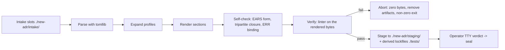

<!-- SPDX-FileCopyrightText: 2026 InsiderCrush -->
<!-- SPDX-License-Identifier: CC-BY-NC-4.0 -->

# ADR-L0-000013. The ADR Compiler

## Status
Accepted

## Context
The ADR compiler is the authoring instrument of the bundle: it renders normative documents from slot files, verifies their form, and stages drafts for seal. The first version was bootstrap scaffolding; its purpose was to birth the canonical instrument descriptions, and it dies when the canonical compiler passes acceptance. Two operator decisions shape this document: the compiler is a separate instrument type (an authoring instrument, not a verification instrument), and one ADR describes one instrument, with volatile measurements living in bundle records and derived lockfiles, never in the ADR. Six bootstrap defects recorded in the debt ledger on 2026-10-03 are encoded here as norms with checks; every check carries a norm_ref to its ratified L0 R-point. The vocabulary of this document is registered in the canonical glossary; see Glossary References. DEBT A21, A22 and A24 carry the related records for the date channel, the test contour, and the hash ledger.

## Decision
### R1. Authoring Boundary
The compiler renders and stages normative documents; it never mutates the corpus and seals nothing — a seal exists only after the operator TTY verdict.

### R2. Transactionality
A failed compile leaves zero bytes of output, removes every artifact of the failed run, and exits non-zero; partial documents are prohibited.

### R3. Zone Discipline
The compiler reads only from ./new-adr/intake/ and ./specs/ (read-only); it writes only to ./new-adr/staging/ and the derived lockfiles under ./tests/.

### R4. Deterministic Inputs
Date and generated_at values come exclusively from slot fields; wall-clock stamps are prohibited.

### R5. Derivability of Checks
Every enforced check derives from a ratified L0 R-point recorded in its norm_ref; ad-hoc compiler-invented norms are prohibited.

### R6. Form Only
The compiler evaluates document form and never content merit; output and diagnostics use the closed vocabulary and the shall modality per ADR-L0-000003 and ADR-L0-000004.

### R7. Zero Embedded Data
The compiler holds no normative data; templates, schemas, thresholds, and vocabularies are read from ratified documents or registered data files at execution time.

### R8. Deterministic Lowering
The lowering stage from the slot AST to the rendered document is a pure deterministic transformation executed exclusively by standard code; neural network calls, generative heuristics, and external API dependencies are prohibited in the compiler pipeline.

## Structural Topology / Reference Pattern

## Requirements (EARS)
- **REQ-L0-000013-001 (Ubiquitous):**
  The compiler shall parse slot files exclusively with the standard tomllib parser.
  | Verification: test_tomllib_only_parsing()

- **REQ-L0-000013-002 (Ubiquitous):**
  The compiler shall read inputs only from ./new-adr/intake/ and ./specs/ (read-only), and shall write only to ./new-adr/staging/ and the derived lockfiles under ./tests/.
  | Verification: test_zone_read_write_paths()

- **REQ-L0-000013-003 (Ubiquitous):**
  The compiler shall resolve every path relative to the bundle root (the governance/ directory) and never from the current working directory.
  | Verification: test_paths_resolved_bundle_relative()

- **REQ-L0-000013-004 (Event-driven):**
  When the compiler is invoked in self-test mode, the compiler shall run its mutation self-test before processing any input.
  | Verification: test_mutation_self_test_runs_first()

- **REQ-L0-000013-005 (Event-driven):**
  When any compilation step fails, the compiler shall remove every artifact of the failed run, abort with zero bytes of output, and exit with a non-zero code.
  | Verification: test_zero_bytes_on_error()

- **REQ-L0-000013-006 (State-driven):**
  While rendering the error catalog, the compiler shall bind every error code to its requirement by req_num and never by loop index.
  | Verification: test_err_binding_by_req_num()

- **REQ-L0-000013-007 (Event-driven):**
  When the document title contains non-ASCII characters, the compiler shall refuse with an explicit diagnostic.
  | Verification: test_non_ascii_title_refused()

- **REQ-L0-000013-008 (Ubiquitous):**
  The compiler shall take the document date and generated_at values exclusively from the slot fields.
  | Verification: test_deterministic_date_from_slots()

- **REQ-L0-000013-009 (State-driven):**
  While verifying a compiled draft, the compiler shall lint the exact rendered bytes to be sealed and never an intermediate draft.
  | Verification: test_verify_lints_rendered_bytes()

- **REQ-L0-000013-010 (State-driven):**
  While closing the tripartite sets of requirements, error codes, and checks, the compiler shall assert referential integrity and orphan policy: every referenced error code exists in the error catalog, and every cataloged code is bound to a requirement or a check, with divergence diagnostics listing every difference.
  | Verification: test_tripartite_closure_with_diagnostics()

- **REQ-L0-000013-011 (Ubiquitous):**
  The compiler shall derive every enforced check from a ratified L0 R-point, and shall refuse enforcement of an un-derived check under error ERR-L0-000013-4.
  | Verification: test_checks_derive_from_l0_rpoints()

- **REQ-L0-000013-012 (State-driven):**
  While rendering, the compiler shall refuse any bypass of a mandatory section that lacks a registered justification under error ERR-L0-000013-6.
  | Verification: test_unjustified_bypass_refused()

- **REQ-L0-000013-013 (State-driven):**
  While expanding profiles, the compiler shall enforce the context ceiling of the active profile and refuse expansion beyond it under error ERR-L0-000013-7.
  | Verification: test_context_ceiling_enforced()

- **REQ-L0-000013-014 (Ubiquitous):**
  The compiler shall never seal a document without an explicit interactive operator TTY verdict under error ERR-L0-000013-8.
  | Verification: test_no_seal_without_tty_verdict()

- **REQ-L0-000013-015 (State-driven):**
  While the compiler verdict and the governance linter verdict disagree, the compiler shall refuse the seal and report the divergence.
  | Verification: test_compiler_linter_divergence_refused()

- **REQ-L0-000013-016 (Ubiquitous):**
  The compiler shall evaluate document form only and shall never rank, rewrite, or reject content by merit.
  | Verification: test_no_semantic_evaluation()

- **REQ-L0-000013-017 (Ubiquitous):**
  The compiler shall hold no normative data; every template, schema, threshold, and vocabulary the compiler applies shall be read from ratified documents or registered data files at execution time.
  | Verification: test_no_embedded_normative_data()

- **REQ-L0-000013-018 (Optional feature):**
  Where a ratified corpus document possesses a corresponding registered slot file in ./new-adr/intake/, the compiler shall re-emit the exact rendered document from that slot source.
  | Verification: test_corpus_reemission_from_slots()

- **REQ-L0-000013-019 (Event-driven):**
  When a mandatory slot section is absent, the compiler shall refuse under error ERR-L0-000013-1.
  | Verification: test_missing_slot_refused()

- **REQ-L0-000013-020 (Event-driven):**
  When a slot field has a type that mismatches the slot schema, the compiler shall refuse under error ERR-L0-000013-2.
  | Verification: test_slot_type_mismatch_refused()

- **REQ-L0-000013-021 (Event-driven):**
  When an identifier lies outside the declared allocated-ranges, the compiler shall refuse under error ERR-L0-000013-3.
  | Verification: test_out_of_range_identifier_refused()

- **REQ-L0-000013-022 (Event-driven):**
  When a requirement statement matches no canonical EARS pattern or violates the canonical clause order, the compiler shall refuse under error ERR-L0-000013-5.
  | Verification: test_invalid_ears_statement_refused()

- **REQ-L0-000013-023 (Event-driven):**
  When the rendered layout stamp differs from the registered template hash, the compiler shall refuse under error ERR-L0-000013-11.
  | Verification: test_layout_stamp_mismatch_refused()

## Checks & Verification Matrix
| Check Name                | Target Artifact            | Verification Gate  | Error Code         | Failure Condition                                                            |
| :------------------------ | :------------------------- | :----------------- | :----------------- | :--------------------------------------------------------------------------- |
| Parse Guard               | ./new-adr/intake/          | compiler self-test | `ERR-L0-000013-10` | A fallback parser is used or tomllib rejects a valid file.                   |
| Zone Guard                | ./governance/ tree         | compiler self-test | `ERR-L0-000013-17` | The compiler reads or writes outside the declared zones.                     |
| Anchor Guard              | ./governance/ tree         | compiler self-test | `ERR-L0-000013-20` | A path resolves outside the bundle-relative anchor.                          |
| Transactional Abort Guard | ./new-adr/staging/         | compiler self-test | `ERR-L0-000013-18` | Output bytes or staged drafts survive a failed run.                          |
| Self-Test First Guard     | ./instruments/             | compiler self-test | `ERR-L0-000013-19` | Input is processed before the mutation self-test.                            |
| ERR Binding Guard         | rendered draft             | compiler self-test | `ERR-L0-000013-13` | An error code is bound by loop index.                                        |
| Title Guard               | rendered draft             | compiler self-test | `ERR-L0-000013-14` | A non-ASCII title renders as an empty kebab segment.                         |
| Deterministic Stamp Guard | derived lockfiles ./tests/ | pre-commit         | `ERR-L0-000013-16` | A wall-clock date or generated_at is detected.                               |
| Sealed Integrity Guard    | staged document            | pre-commit         | `ERR-L0-000013-12` | The linter runs against an intermediate draft instead of the rendered bytes. |
| Tripartite Closure Guard  | staged document            | compiler self-test | `ERR-L0-000013-15` | Set mismatch without divergence diagnostics.                                 |
| No-Self-Seal Guard        | ./new-adr/staging/         | pre-commit         | `ERR-L0-000013-8`  | A document is sealed without the operator TTY verdict.                       |
| Divergence Guard          | ./new-adr/staging/         | pre-commit         | `ERR-L0-000013-9`  | The compiler verdict disagrees with the governance linter verdict.           |
| Schema Guard              | ./new-adr/intake/          | compiler self-test | `ERR-L0-000013-1`  | A mandatory slot section is absent.                                          |
| Type Guard                | ./new-adr/intake/          | compiler self-test | `ERR-L0-000013-2`  | A slot field has the wrong type.                                             |
| Range Guard               | ./new-adr/intake/          | compiler self-test | `ERR-L0-000013-3`  | A REQ or ERR identifier lies outside the declared allocated-ranges.          |
| EARS Form Guard           | rendered draft             | compiler self-test | `ERR-L0-000013-5`  | A requirement matches no canonical EARS pattern or violates clause order.    |
| Layout Stamp Guard        | rendered draft             | compiler self-test | `ERR-L0-000013-11` | The rendered layout stamp differs from the template hash.                    |
| Reference Guard           | rendered draft             | compiler self-test | `ERR-L0-000013-4`  | A norm, term, or identifier resolves to nothing.                             |
| Bypass Guard              | rendered draft             | compiler self-test | `ERR-L0-000013-6`  | A mandatory section is bypassed without a registered justification.          |
| Context Ceiling Guard     | rendered draft             | compiler self-test | `ERR-L0-000013-7`  | Profile expansion exceeds the context ceiling.                               |

## Error Catalog & Machine Remediation
- **`ERR-L0-000013-1` (MISSING-SLOT):**
  - *Trigger:* A mandatory slot or section is absent.
  - *Remediation:* Restore the slot or register a justified bypass.

- **`ERR-L0-000013-2` (SLOT-TYPE-MISMATCH):**
  - *Trigger:* A slot field has the wrong type.
  - *Remediation:* Fix the field type to match the slot schema.

- **`ERR-L0-000013-3` (OUT-OF-RANGE-IDENTIFIER):**
  - *Trigger:* A REQ or ERR identifier lies outside the declared allocated-ranges.
  - *Remediation:* Renumber inside the document range per ADR-L0-000002.

- **`ERR-L0-000013-4` (UNRESOLVED-REFERENCE):**
  - *Trigger:* A check or slot references an unknown norm, term, or identifier.
  - *Remediation:* Register the target or correct the reference.

- **`ERR-L0-000013-5` (INVALID-EARS-STATEMENT):**
  - *Trigger:* A requirement matches no canonical EARS pattern or violates clause order.
  - *Remediation:* Rewrite per ADR-L0-000004 patterns and clause order.

- **`ERR-L0-000013-6` (UNJUSTIFIED-BYPASS):**
  - *Trigger:* A mandatory section is bypassed without a registered justification.
  - *Remediation:* Restore the section or register the bypass justification.

- **`ERR-L0-000013-7` (CONTEXT-CEILING-EXCEEDED):**
  - *Trigger:* Profile expansion exceeds the context ceiling.
  - *Remediation:* Split the content or request a norm change; silent overflow is prohibited.

- **`ERR-L0-000013-8` (SEAL-BEFORE-VERDICT):**
  - *Trigger:* A seal is attempted without the operator TTY verdict.
  - *Remediation:* Stage the draft and wait for the operator verdict.

- **`ERR-L0-000013-9` (COMPILER-LINTER-DIVERGENCE):**
  - *Trigger:* Compiler verdict and governance linter verdict disagree.
  - *Remediation:* Report the divergence; reconcile the norms before any seal.

- **`ERR-L0-000013-10` (SLOT-PARSE-FAILURE):**
  - *Trigger:* tomllib cannot parse the slot file.
  - *Remediation:* Fix the TOML; fallback parsers are prohibited.

- **`ERR-L0-000013-11` (LAYOUT-STAMP-MISMATCH):**
  - *Trigger:* The rendered layout stamp differs from the template hash.
  - *Remediation:* Regenerate with the registered template or fix the template reference.

- **`ERR-L0-000013-12` (SEALED-INTEGRITY-MISMATCH):**
  - *Trigger:* Verification ran against an intermediate draft instead of the rendered bytes.
  - *Remediation:* Lint the exact bytes staged for seal.

- **`ERR-L0-000013-13` (ERR-BINDING-MISALIGNMENT):**
  - *Trigger:* An error code is bound by loop index instead of req_num.
  - *Remediation:* Bind by req_num explicitly.

- **`ERR-L0-000013-14` (INVALID-KEBAB-TITLE):**
  - *Trigger:* A non-ASCII title produces an empty or broken kebab segment.
  - *Remediation:* Refuse with a diagnostic; titles are English per the channel rules.

- **`ERR-L0-000013-15` (TRIPARTITE-CLOSURE-DIVERGENCE):**
  - *Trigger:* The closure sets diverge without diagnostics.
  - *Remediation:* Emit the full divergence list and abort.

- **`ERR-L0-000013-16` (DETERMINISTIC-DATE-MISSING):**
  - *Trigger:* A date or generated_at comes from the wall clock.
  - *Remediation:* Supply both in the slot fields.

- **`ERR-L0-000013-17` (ZONE-DIVERGENCE):**
  - *Trigger:* The compiler reads or writes outside its declared zones.
  - *Remediation:* Restrict to intake reads and staging plus ./tests/ lockfile writes.

- **`ERR-L0-000013-18` (PARTIAL-OUTPUT-ON-ERROR):**
  - *Trigger:* Output bytes or staged drafts survive a failed run.
  - *Remediation:* Delete the artifacts and abort with a non-zero exit code.

- **`ERR-L0-000013-19` (MUTATION-SELF-TEST-MISSING):**
  - *Trigger:* Input is processed before the mutation self-test.
  - *Remediation:* Run the self-test first.

- **`ERR-L0-000013-20` (PATH-NOT-BUNDLE-RELATIVE):**
  - *Trigger:* A path resolves outside the bundle-relative anchor.
  - *Remediation:* Anchor the path with ./ from the bundle root per ADR-L0-000001/R5.3.

## Consequences
### Positive
- The bundle gains a ratified description of its authoring instrument; the canonical compiler is born per norm, not per the bootstrap code.
- All six bootstrap defects become verifiable norms with error codes and ratified derivations; the acceptance suite of the canonical compiler derives from this document.

### Negative
- The corpus grows by one document; every future compiler change that mutates a requirement text requires a SemVer bump under ADR-L0-000011.
- The compiler is constrained to form-only evaluation; content decisions remain with the operator.

## Alternatives Considered
- **Compiler as an instance of the verification-instrument class:** Rejected. Operator verdict: an authoring instrument transforms state, a verification instrument only measures; merging the two blurs the risk profiles and the verdict semantics.
- **Split class ADR plus instance SDD:** Rejected. Operator verdict: with a single compiler the class document carries zero data; one ADR per instrument preserves the one-subject-one-document pattern of ADR-L0-000001 through ADR-L0-000012.
- **Hand-written compiler ADR:** Rejected. Hand authorship repeats the form errors catalogued in the debt ledger; the conveyor exists precisely to eliminate them.

## Bypass Manifest

| Field                    | Reason                                                                                                   |
| :----------------------- | :------------------------------------------------------------------------------------------------------- |
| anti_pattern_catalog     | Anti-patterns are owned by ADR-L0-000004 and the debt ledger, not duplicated here.                       |
| context_budget_matrix    | Profile context ceilings are normative via ERR-L0-000013-7 and are tuned in the compiler bundle records. |
| fsm_state_registry       | Compile stages form a pipeline, not a lifecycle FSM; no state registry applies.                          |
| linter_payload_schema    | Payload schema is owned by the linter document (ADR-L0-000014) and is ratified there.                    |
| pattern_selection_matrix | The six canonical EARS patterns are mandatory per ADR-L0-000004; no selection applies.                   |
| transition_matrix        | No FSM transitions exist; the document fixes norms, not states.                                          |

## Glossary References

| Term (EN)               | Term (RU)                  |
| :---------------------- | :------------------------- |
| authoring-instrument    | инструмент порождения      |
| bundle-root             | корень бандла              |
| compiler                | компилятор                 |
| corpus-rebirth          | перерождение корпуса       |
| derivation              | деривация нормы            |
| deterministic-lowering  | детерминированный лоуэринг |
| err-identifier          | ERR-идентификатор          |
| error-catalog           | каталог ошибок             |
| form-only-evaluation    | оценка только формы        |
| formula-b               | формула Б                  |
| intake                  | интейк                     |
| mutation-self-test      | мутационный самотест       |
| norm-ref                | norm_ref                   |
| orphan-policy           | политика сирот             |
| preflight               | префлайт                   |
| ratification            | ратификация                |
| referential-integrity   | ссылочная целостность      |
| seal                    | печать                     |
| self-hosting            | самоподдержка              |
| slot-file               | слот-файл                  |
| staging                 | стейджинг                  |
| transactionality        | транзакционность           |
| tripartite-closure      | трипартитное замыкание     |
| tty-verdict             | вердикт TTY                |
| verification-instrument | инструмент верификации     |
| zero-embedded-data      | ноль данных в коде         |
